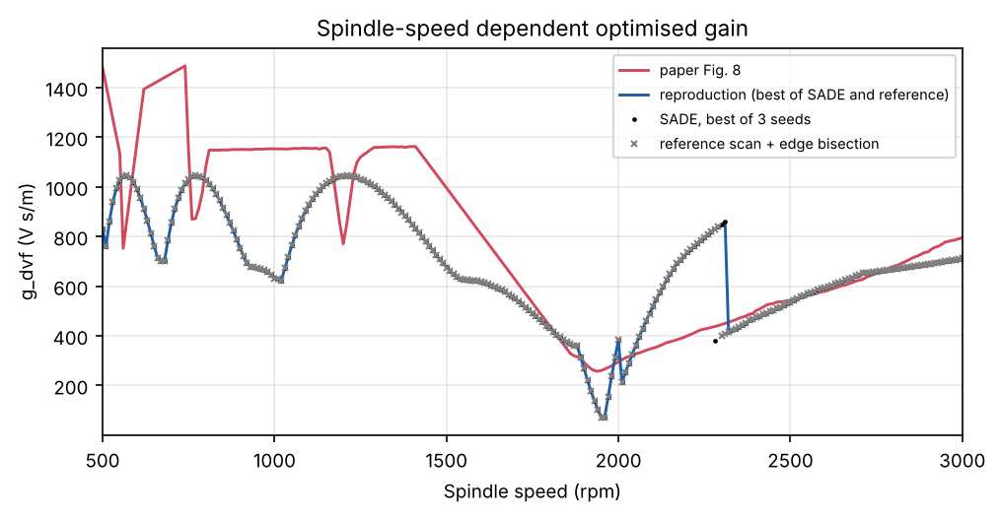
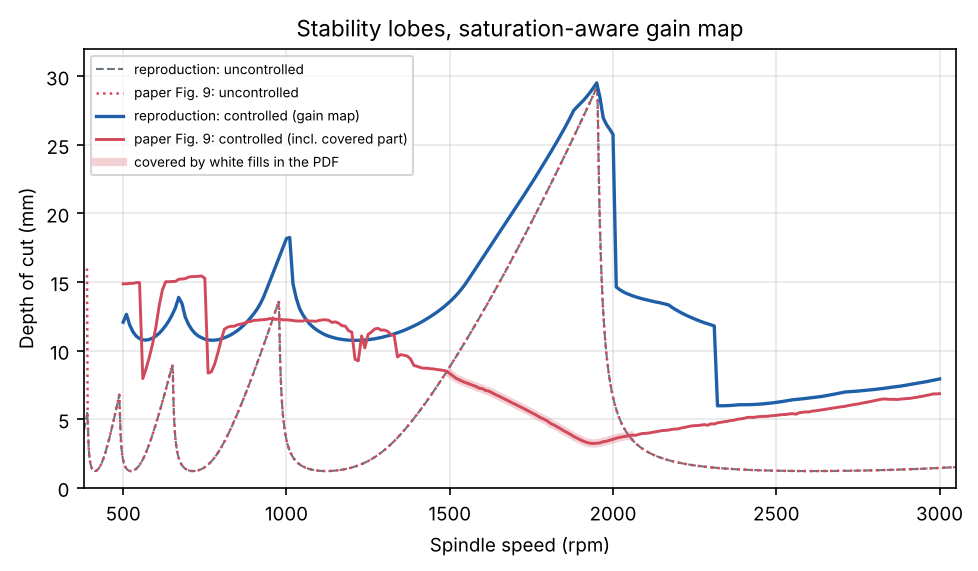
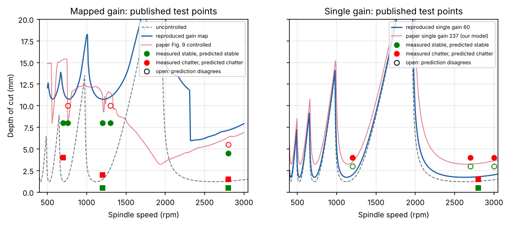
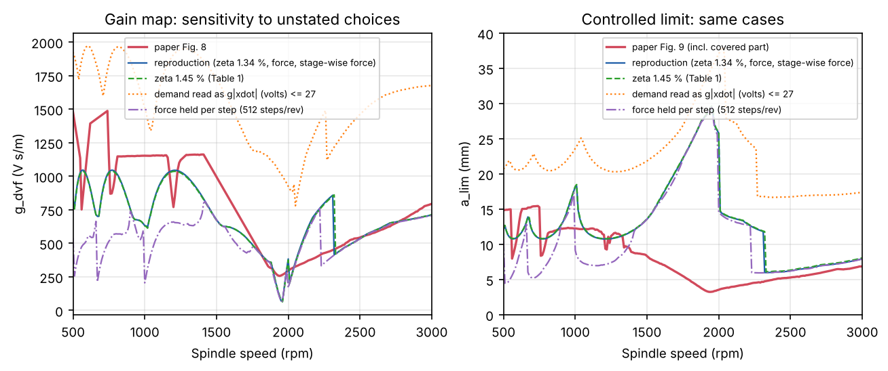

# إعادة إنتاج Ozsoy, Sims & Ozturk (2026) من الصفر

> M. Ozsoy, N. D. Sims, E. Ozturk, *Robust active control of milling chatter under actuator
> constraints: a spindle speed mapped framework with experimental validation*,
> **J. Manufacturing Processes 171 (2026) 247–257**. doi:10.1016/j.jmapro.2026.05.009
> (CC BY‑NC‑ND — لم يُنسخ أيّ نصّ منها هنا؛ الأرقام والمنحنيات المأخوذة منها مذكورة المصدر.)

كلّ ما في هذا المجلّد مكتوب من جديد: النموذج، حلّال حدّ الاستقرار، المحاكي الزمني، المُحسِّن،
والمقارنة. ولأنّ الورقة لا تنشر كودها، فالمقارنة تتمّ مع **بياناتها المرسومة نفسها**: الأشكال
5 و6a و8 و9 مخزّنة في ملف الـ PDF كمسارات متّجهية، فاستُرجعت إحداثياتها بدقّة (لا بالعين) في
[`digitized/`](digitized/)، والشكل 11 النقطي رُقِّم بالألوان مع تقدير للخطأ.

## الخلاصة في عشرة أسطر

1. **النموذج مُعاد بدقّة**: حدّ الاستقرار غير المتحكَّم فيه يطابق الورقة بوسيط 0.04 % — لكن
   بتخميد **1.34 %**، لا 1.45 % المذكور في الجدول 1 (كلّ منحنيات الورقة المحسوبة تستعمل 1.34 %).
2. **الطريقة مُعادة كاملةً** وكلّ جزء منها متحقَّق منه بحلّال مستقلّ (SDM، ZOH دقيق، قوّة غاشمة).
   فحوص [`verification/`](verification/) الأولى جرت قبل إصلاح المحاكي، فالصيغة النهائية فُحصت بعدها
   في [`check7`](verification/tdsim/check7_final_scheme.json): انحراف 0.10–0.63 % عن الحلّ المتقارب.
3. **الكسب في 2320–3000 rpm يطابق الورقة** (نسبة الوسيط 0.97، المدى 0.90–1.04؛ 536 مقابل 543
   عند 2500 rpm)، لكنه أكبر منها بـ 1.2–1.9× في 2060–2310 rpm. **ومستوى العمق المتحكَّم فيه
   تحت 1500 rpm يطابقها** (نسبة الوسيط 0.97–1.02، لا الشكل: النسبة لكلّ سرعة 0.71–1.49) بكسوبٍ
   أصغر بـ 12–26 % (وسيطًا).
4. **جزء من الشكل 9 مغطّى بمستطيلات بيضاء في الـ PDF** (1498–2051 rpm)، وهو بالضبط حيث
   ينزل المنحنى المتحكَّم فيه تحت غير المتحكَّم فيه — وهو ما تمنعه معادلة الورقة (2).
5. **الكسب الثابت يخرج 60 V·s/m لا 237**؛ و237 غير مقبول عند 18 سرعة قرب الرنين القسري.
6. **مقارنة DVF المقصوص تنعكس**: في نموذجنا يتفوّق المقصوص عند كلّ السرعات، لأنّ شرط الجدوى
   المقيَّم عند $a_{\lim}$ بالضبط يعاقب إشباع لحظة الدخول.
7. **النقاط التجريبية**: 19/21 متّسقة بكسوب الورقة، 15/21 بكسوبنا؛ الفرق كلّه تقريبًا من الكسب الثابت.
8. اكتشفنا وأصلحنا **تأخّر نصف خطوة** في الصيغة المعتادة للمحاكاة الزمنية؛ هذا الخيار وحده يحرّك
   الكسب منخفض السرعة بعامل حتى 3.
9. ستّة اختيارات لا تذكرها الورقة موثّقة (§4.6)، وأثر أربعة منها مقيس: وحدة الطلب وطريقة إدخال
   القوّة (§6)، وإعدادات SADE (§3)، وكسب DVF المقصوص (§5.5).
10. التجارب نفسها لا تُعاد؛ بدلًا منها تُصنَّف النقاط الـ 21 وتُحاكى القطوع الستّ الموسومة.

---

## 1. ما الذي يُعاد إنتاجه، وما الذي لا يمكن

| عنصر الورقة | الحالة هنا |
|---|---|
| النموذج: نمط واحد + مشغّل الكتلة الخاملة (المعادلة 3) + DVF (المعادلة 1) | مبنيّ ومُتحقَّق منه |
| الشكل 6: FRF الحلقة المغلقة ومواقع الأقطاب | مُعاد، مع منحنيات الورقة فوقه |
| حدّ الاستقرار الترددي (ZOA) | مُعاد، ومتحقَّق منه بحلّالَي SDM مستقلّين |
| المحاكاة الزمنية (512 خطوة/دورة، 50 دورة، 30 شريحة) | مُعادة بلغة C؛ الصيغة النهائية (قوّة لكلّ مرحلة) تنحرف 0.10–0.63 % عن حلّ ZOH الدقيق المتقارب (8192 خطوة/دورة)، والصيغة القديمة 1.7–7.8 % |
| SADE ودالّة اللياقة (المعادلة 2) | مُعادان، ومعهما مرجع حتمي يكشف إن بلغ SADE القيمة المثلى |
| الشكل 8: خريطة الكسب على 251 سرعة | مُعادة |
| الشكل 9: حدّ الاستقرار المتحكَّم فيه | مُعاد |
| الشكل 11 والكسب الثابت 237 V·s/m | أُعيد حسابه و**لم يُطابِق**: الكسب الثابت يخرج 60.3 V·s/m لا 237 (§5.4) |
| الجدول 3: DVF المقصوص مقابل الطريقة المقترحة | أُعيد حسابه بالمحاكاة الزمنية و**النتيجة معكوسة**: المقصوص أفضل عند السرعات التسع (§5.5) |
| التجارب (الأشكال 7، 10، 12 والنقاط المقيسة) | **لا تُعاد** — بدلًا منها: كل نقطة من النقاط الـ 21 المنشورة تُصنَّف بالنموذج، والقطوع الستّ الموسومة تُحاكى زمنيًّا |

## 2. النموذج كما بُني

| الكمية | القيمة | المصدر |
|---|---|---|
| النمط المهيمن | $f_n=129.3$ Hz، $k=1.34\times10^{7}$ N/m، $m=k/\omega_n^2=20.30$ kg | الجدول 1 |
| التخميد | **1.34 %** في كلّ الحسابات (الجدول 1 يقول 1.45 %) | §4.1 |
| المشغّل | $G_a(s)=3s^2/(s^2+15.834s+2785.6)$ N/V، $F_{\max}=27$ N | المعادلة 3، §2.1–2.2 |
| القانون | $V=-g\dot x$، $g$ بـ V·s/m؛ الحلقة: $G_{cl}=G/(1+g\,s\,G_aG)$ | المعادلتان 1 و4 |
| القطع | Ø16 mm، 4 أسنان، حلزون 45°، $K_{tc}=660$، $K_{rc}=180$ MPa، تفريز نازل بنصف غمر، 0.05 mm/سن | الجدول 2 |
| اتجاه المرونة | عموديّ على التغذية (اتجاه دفع المشغّل في الشكل 3a)؛ $\alpha_{yy}=-1-\frac{\pi}{2}\frac{K_{rc}}{K_{tc}}=-1.428$ | افتراض، مؤكَّد بمطابقة الشكل 9 |

**حدّ الاستقرار.** لكلّ سرعة يُحلّ $1-\frac{N K_{tc} a}{4\pi}\alpha_{yy}(1-e^{-i\omega T})G_{cl}(i\omega)=0$
مباشرةً: مسحٌ على $\omega$، وكلّ جذر حقيقي موجب لـ $a(\omega)$ هو عبور، وأصغرها $a_{\lim}$.
لا تقاطع فصوص ولا استيفاء بينها ([`src/zoa.py`](src/zoa.py)).

**المحاكاة الزمنية** ([`src/tdsim.c`](src/tdsim.c)). سماكة رقاقة تجديدية لكلّ شريحة وسنّ، وقوّة
صفر عند الانفصال، والحلقة (بنية + مشغّل + DVF + حدّ جهد اختياري) تُكامَل بـ RK4. **قوّة القطع
تُعاد حسابها عند كلّ مرحلة من مراحل RK4** (الزوايا تتقدّم، والإزاحة المتأخّرة من استيفاء
Hermite للتاريخ). الصيغة المعتادة — قوّة ثابتة على الخطوة — تؤخّر القوّة نصف خطوة، وعند 512
خطوة/دورة يُخفّض ذلك حدّ الاستقرار الزمني حتى 9 % ويُضخّم الطلب المحسوب تحت 1300 rpm بعامل
وسيطه 1.6× (المئين 90: ‏3.3×) على شبكة المسح؛ بالصيغة الجديدة يطابق الطلب عند 512 خطوة نتيجةَ 8192
إلى 0.18 %. الصيغة القديمة باقية
خيارًا (`fmode=0`) ومقيسةٌ في §6.

**اللياقة والمُحسِّن** ([`src/objective.py`](src/objective.py)، [`src/sade.py`](src/sade.py)).
اللياقة = $a_{\lim}(\Omega,g)$ إن بقي الطلب الأقصى $K_a g|\dot x|\le 27$ N طوال المحاكاة عند العمق
$a_{\lim}$ نفسه، وإلّا صفر. SADE بأربع استراتيجيات (Qin–Huang–Suganthan 2009)، 20 فردًا، حتى
60 جيلًا، توقّف عند ركود 25 جيلًا، ثلاث بذور لكلّ سرعة. ومعه **مرجع حتمي**: مسح $g$ بخطوة 20
على $[0,3000]$ ثم تنصيف على حافّة كلّ مجال جدوى. المعتمد هو الأفضل من الاثنين لأنّهما يقيّمان
الدالّة نفسها.

## 3. التحقّق المستقلّ

خمسة فحوص مستقلّة، كلٌّ بكوده الخاص في [`verification/`](verification/)، ثم ناقدٌ يفحص الخمسة:

| الفحص | النتيجة |
|---|---|
| ZOA مقابل SDM لنفس النموذج المتوسَّط ([`zoa_sdm`](verification/zoa_sdm/)) | فرق أقصى $2\times10^{-5}$؛ مقابل مسح الفصوص التقليدي $1.6\times10^{-6}$؛ لا جذور مفقودة |
| ZOA مقابل النموذج الدوري الكامل بالحلزون | ZOA محافظ بـ 0–1.04 % |
| نمط المشغّل (8.4 Hz) | لا يولّد جذورًا منخفضة التردد ما دام $g<2.4\times10^4$ V·s/m |
| المحاكي بالصيغة القديمة مقابل ZOH دقيق بالخطوة نفسها ([`tdsim`](verification/tdsim/)) | $\le4.5\times10^{-5}$ ($10^{-3}$ في ارتجاج سريع النموّ)؛ مرجعا ZOH المستقلّان متطابقان إلى $3.8\times10^{-12}$؛ القوّة المتوسّطة مطابقة للصيغة التحليلية؛ اتجاه الحلزون والقصّ صحيحان |
| الصيغة النهائية مقابل ZOH دقيق متقارب، 8192 خطوة ([`check7`](verification/tdsim/check7_final_scheme.json)) | 0.10–0.63 % عند 512 خطوة (القديمة: 1.7–7.8 %)؛ الطلب عند $a_{\lim}$ ضمن 0.18 % |
| حدّ المحاكاة الزمنية مقابل ZOA (الصيغة النهائية، 8 حالات) | +0.4 % إلى +2.2 % |
| SADE ([`sade`](verification/sade/)) | مطابق للخوارزمية؛ بإعدادات النافذة 25 بلغ الحلّ الأمثل بالقوّة الغاشمة في 30/30 تشغيلة |

الفحوص الخمسة جرت على الكود قبل الإصلاح، وكشفت **ثلاثة عيوب عددية عندنا أُصلحت قبل التشغيل النهائي**: تأخّر نصف الخطوة في
القوّة، وكاشف ارتجاج يخطئ في الحالات الحدّية (استُبدل بمعيار التلاشي مرّةً لكلّ سنّ)، ونافذة
ركود قصيرة توقف SADE قبل الحافّة. كما أُزيلت جذور زائفة نادرة عند توافقيات مرور الأسنان.

## 4. ما كشفته إعادة الإنتاج في الورقة نفسها

البنود 4.1–4.5 أرقامٌ مقيسة من بيانات الورقة المتّجهية، وسكربتاتها في
[`verification/consistency/`](verification/consistency/) (ملخّص إنجليزي:
[`findings.md`](verification/consistency/findings.md))، عدا بند الشكل 11 في 4.5 فهو مقروء من صورته
النقطية ([`fig11_gain_fit.py`](verification/critic/fig11_gain_fit.py)). أمّا 4.6 فيسرد اختياراتنا نحن.
لا يُستنتج من أيّ بند قصدٌ.

### 4.1 التخميد المستعمل في الحسابات هو 1.34 % لا 1.45 %

منحنى «المُعرَّف» في الشكل 5 هو الجدول 1 بالضبط (ملاءمة حرّة: 129.307 Hz، 1.4499 %،
$1.3401\times10^7$ N/m). لكنّ **كلّ منحنى محسوب** يلائم 1.34 %: قمّة FRF غير المتحكَّم فيه
في الشكل 6a ($-111.10$ dB مقابل $-111.79$ لو كانت 1.45 %)، والقطب المفتوح في الشكل 6b
(1.3405 %)، وحدّ الاستقرار غير المتحكَّم فيه في الشكل 9 (1.3394 %؛ بقايا لوغاريتمية
0.00045 مقابل 0.063 لو كانت 1.45 %). بـ 1.34 % يطابق نموذجنا منحنى الشكل 9 بوسيط 0.04 %
على كلّ السرعات. ولافتٌ أنّ 1.34 هي أيضًا مانتيسا الصلابة ($1.34\times10^7$).

### 4.2 تسميات الكسب في الشكل 6 لا توافق منحنياته

اللوحتان 6a و6b متّفقتان فيما بينهما، لكنّهما توافقان الكسب المكتوب عند 1300 rpm فقط (1162).
المنحنيات والأقطاب المرسومة تقابل **1543 و685 و830** V·s/m مقابل التسميات 1487 و585 و797.

### 4.3 منحنى الشكل 9 المتحكَّم فيه: جزءٌ منه مغطّى، وهو تحت المنحنى غير المتحكَّم فيه

في ملف الـ PDF رُسمت **ستّة مستطيلات بيضاء** بعد المنحنيين وبعد المفتاح؛ خمسةٌ منها تغطّي
المنحنى المتحكَّم فيه على **1498.5–2050.8 rpm** و**958.5–975.4 rpm** (58 من رؤوسه الـ 250،
ومنها أدناه 3.22 mm عند 1940 rpm). هذان المجالان يطابقان، في حدود 8 rpm، المواضعَ التي يقع
فيها المنحنى المتحكَّم فيه **تحت** غير المتحكَّم فيه — بفارق يبلغ 25.9 mm عند 1950 rpm
(3.24 مقابل 29.17 mm). وهذا مستحيل تحت المعادلة (2): الكسب $g=0$ طلبُه صفر فهو مقبول دائمًا،
ولياقته هي الحدّ غير المتحكَّم فيه.

وخارج هذين المجالين أيضًا: المنحنى المتحكَّم فيه **ليس** $a_{\lim}$ الترددي عند كسب الشكل 8
نفسه (على السرعات الـ 192 خارجهما: وسيط الانحراف 18 %، و2 فقط ضمن 2 % و14 ضمن 5 %)، رغم أنّ النموذج نفسه يطابق
الشكل 6 والمنحنى غير المتحكَّم فيه. اختُبرت فرضيتان — «قاع الفصّ» و«العمق المحدود بالقوّة» —
ولم تفسّر أيٌّ منهما المنحنى كلّه.

### 4.4 خريطة الكسب (الشكل 8) فيها مقاطع مستقيمة تمامًا

37 من 251 سرعة بلا رأس؛ المنحنى خطّي حرفيًّا على 1410–1860 rpm (46 سرعة) و620–740 rpm
وعلى 500–550 و560–610 rpm. الفرضية: استيفاءٌ بين سرعات حُسّنت، لا نتائج تحسين. هذه المقاطع
مستبعدة من المقارنات الصارمة أدناه. ونطاق النصّ «237–1487» لا يطابق أدنى الشكل (256.9 عند
1940 rpm)؛ 237 هو كسب البديل الثابت.

### 4.5 أرقام لا تتّسق فيما بينها

* عند 1300 rpm تعطي الورقة أربعة أعماق: 10 (نصّ)، 11.49 (الشكل 9)، 11.8 (المثال المحلول
  بكسب مرفوض 1240)، 12.0 mm (الجدول 3 بكسب أصغر ≈1160). المثال والجدول متعارضان ما دام
  $a_{\lim}$ يزيد مع $g$ — وهو يزيد في النموذج عند هذه السرعة.
* عمود «المقترحة» في الجدول 3 أعلى من الشكل 9 بـ 0.24–0.51 mm عند 1300 و2300 و2800 و3000.
* «أسوأ حالة 1.2 → 3.6 mm»: 1.2 صحيحة (1.212)، لكن لا قيمة دنيا للمنحنى المتحكَّم فيه تساوي
  3.6 (المغطّاة 3.22، الظاهرة 3.80).
* «≈13 ضعفًا قرب 730 rpm»: المرسوم 12.15 عند 730 (أقصاه 12.65 عند 710) — متّسق بعد التقريب.
* منحنى الشكل 11 «بالكسب الثابت 237» يلائمه أفضلَ كسبٌ ثابت قدره **≈270** (بقايا 0.8 %)؛
  عند 237 يقع النموذج تحته بـ 7.3 %.

### 4.6 ما لا تذكره الورقة واضطُررنا لاختياره

| الغموض | الاختيار هنا | أثره (§6) |
|---|---|---|
| وحدة الطلب: $F_d=g\dot x$ و$g$ بـ V·s/m فالناتج فولت، ويُقارَن بـ 27 N | القوّة $K_a g|\dot x|$ (3 N/V) | قراءة «الفولت» تضاعف الكسب 2–3× |
| مجال البحث $\mathcal G$ | $[0,\,3000]$ V·s/m | الحدّ الأدنى صفر يضمن ألّا يقلّ المتحكَّم فيه عن غيره |
| إعدادات SADE | 20 فردًا، ≤60 جيلًا، ركود 25، 3 بذور | متحقَّق منها بالقوّة الغاشمة |
| كيف تدخل القوّة المحاكاة | تُعاد عند كلّ مرحلة RK4 | الصيغة الثابتة على الخطوة تُخفّض الكسب منخفض السرعة حتى 3× |
| كسب DVF «المقصوص» | قيمتان مفترضتان: 1500 (فوق أكبر كسب في الشكل 8) و3000 (حدّ $\mathcal G$ هنا) | §5.5 |
| المرجع [56] لـ SADE | Worden & Manson 2012؛ المطبَّق هو SaDE لـ Qin وآخرين 2009 | لا أثر في بُعدٍ واحد |

## 5. النتائج مقابل الورقة

### 5.1 النموذج المفتوح والمغلق (الشكلان 5 و6) — مُعاد

* بـ 1.34 % يطابق حدّ الاستقرار غير المتحكَّم فيه منحنى الشكل 9 بوسيط **0.04 %** (أقصى 0.7 %
  على الجوانب الحادّة للفصوص)، وقمم الفصوص كلّها: في الورقة 6.78 / 8.99 / 13.64 / 29.27 mm عند 488 / 651 / 977 / 1952 rpm،
  ونموذجنا عند السرعات نفسها 6.78 / 8.99 / 13.63 / 29.26 mm؛ وأدناها 1.213 mm.
* FRF الحلقة المغلقة وأقطابها عند 1300 rpm ($g=1162$) مطابقة حرفيًّا؛ وعند السرعات الثلاث الأخرى
  تطابق منحنياتُ الورقة الكسوبَ 1543 و685 و830 لا المكتوبة (§4.2).
  [`figures/r02_fig6_frf_poles.png`](figures/r02_fig6_frf_poles.png)

### 5.2 خريطة الكسب (الشكل 8)



* **SADE يبلغ القيمة المثلى في 250/251 سرعة**: البذور الثلاث متطابقة (< 0.01 mm) في 245/251،
  وSADE والمرجع الحتمي ضمن 1 % في 248/251. حيث يختلفان (2280 و2300 و2310 rpm) فلأنّ مجال الجدوى
  **متشظٍّ**: الطلب عند $a_{\lim}$ ليس رتيبًا في $g$، فيهبط تحت 27 N في جيبٍ ضيّق ($g\approx810$–860)
  يقفز فيه $a_{\lim}$ من ≈6 إلى ≈12 mm. عند 2300 و2310 rpm وجده SADE وفاتَ شبكةَ المرجع (خطوة 20)؛
  وعند 2280 rpm العكس: فاتَ البذورَ الثلاث (5.96 mm) ووجده المرجع (12.03 mm). الخريطة تأخذ الأفضل
  من الطريقتين. هذه خاصّية لدالّة اللياقة نفسها، لا خطأ عدديّ.
* **مقارنة بالورقة** (نسبة الوسيط، مع استبعاد مقاطعها المستقيمة):

  | المجال (rpm) | الكسب: نحن/الورقة | $a$: نحن/الورقة | ملاحظة |
  |---|---:|---:|---|
  | 500–1150 | 0.74 | **1.02** | العمق نفسه بكسب أصغر |
  | 1160–1490 | 0.88 | **0.97** | |
  | 2060–2310 | 1.83 | — | كسبنا أكبر بـ 1.2–1.9× (849 مقابل 445 عند 2300) |
  | 2320–3000 | **0.97** | 1.17 | الكسب نفسه تقريبًا (المدى 0.90–1.04؛ 536 مقابل 543 عند 2500) |
  | 1500–2050 | — | — | منحنى الورقة هنا هو الجزء المغطّى (§4.3)؛ منحنانا لا ينزل تحت غير المتحكَّم فيه |

* مدى الكسب عندنا 71–1046 V·s/m (الورقة 257–1487). أدناه 71 عند **1950 rpm** حيث تردّد مرور
  الأسنان (130 Hz) يكاد يساوي تردّد النمط (129.3 Hz): الاهتزاز القسري رنّان، فلا يحتمل المشغّل إلّا كسبًا صغيرًا.

### 5.3 حدّ الاستقرار المتحكَّم فيه (الشكل 9)



* تحت 1500 rpm يتّفق منحنانا مع الورقة في المستوى (≈11–12 mm) ويختلف في الشكل: منحنى الورقة
  هضباتٌ مسطّحة تفصلها هبوطات حادّة، أطولها في 810–1150 rpm (11.6–12.3 mm) بكسبٍ شبه ثابت
  (1147–1156)؛ وبكسبٍ ثابت قريب منه (1140) يتراوح حدّنا الترددي هناك بين 12 و23 mm.
* في 2320–3000 rpm منحنانا أعلى بـ 17 % بالكسب نفسه تقريبًا — لأنّ منحنى الورقة أدنى من
  $a_{\lim}$ الترددي عند كسوبها هي (§4.3). أمّا في 2060–2310 rpm فالفرق أكبر لأنّ كسوبنا أكبر.
* **أسوأ حالة**: 5.97 mm عند 2330 rpm (الورقة: 3.6). **أقصى تحسين**: 9.7× عند 520 rpm؛ وعند
  730 rpm ‏8.7× (11.06 مقابل 1.27 mm)، والورقة ≈13× (المرسوم 12.15×).

### 5.4 الكسب الثابت (الشكل 11)

* **الكسب الثابت المُعاد = 60.3 V·s/m** (SADE: ‏56.3 و59.1)، لا 237. تحكمه السرعة 1970 rpm
  (قرب الرنين القسري: مرور الأسنان 131.3 Hz مقابل النمط 129.3 Hz). متوسّط $a_{\lim}$ على المدى 6.52 mm وأدناه 1.72 mm.
* الكسب 237 **غير مقبول** في نموذجنا عند 18 سرعة (1910–2010 و2060–2120 rpm). أمّا منحنى
  الورقة «بـ 237» فيلائمه كسبٌ ثابت ≈270 في نموذجنا (§4.5).
* النتيجة: البديل الثابت عندنا أضعف بكثير منه في الورقة، فالفجوة بينه وبين الخريطة أكبر
  (متوسّط 6.5 مقابل 12.75 mm). [`figures/r05_fig11_single_gain_main.png`](figures/r05_fig11_single_gain_main.png)

### 5.5 الجدول 3: DVF المقصوص مقابل الطريقة المقترحة — **النتيجة معكوسة**

| rpm | الورقة: مقصوص | الورقة: مقترحة | نحن: مقصوص $g=1500$ | نحن: مقصوص $g=3000$ | نحن: مقترحة (TD) | نحن: مقترحة (ZOA) |
|---:|---:|---:|---:|---:|---:|---:|
| 500 | 15.2 | 14.9 | 16.97 | 20.40 | 12.10 | 12.07 |
| 560 | 8.7 | 8.0 | 16.18 | 20.36 | 10.84 | 10.78 |
| 600 | 12.2 | 11.8 | 15.64 | 20.16 | 11.10 | 11.06 |
| 800 | 11.2 | 10.8 | 15.31 | 18.91 | 10.91 | 10.85 |
| 1300 | 12.1 | 12.0 | 14.15 | 15.21 | 11.08 | 11.01 |
| 2300 | 4.5 | 4.9 | 13.66 | 13.77 | 12.01 | 11.87 |
| 2500 | 4.7 | 5.3 | 12.95 | 13.18 | 6.36 | 6.22 |
| 2800 | 5.8 | 6.6 | 12.45 | 12.86 | 7.31 | 7.16 |
| 3000 | 6.2 | 7.1 | 12.60 | 12.99 | 8.08 | 7.93 |

(حدود زمنية بكاشف التلاشي ومع حدّ الجهد 9 V؛ ملف: [`results/table3_main.csv`](results/table3_main.csv).)

في نموذجنا **يتفوّق DVF المقصوص عند كلّ السرعات**. السبب مقيس: عند 2500 rpm و10 mm وبـ
$g=3000$ يُشبَع المشغّل **أثناء دخول الأداة فقط**؛ في الحالة المستقرّة الكسب الكبير يُخمد
الاهتزاز القسري حتى لا تبلغ السرعة حدّ 9 V (نسبة زمن الإشباع في آخر 50 دورة: 0 %)، والقطع
مستقرّ؛ بينما يرتجّ الكسب «المقترح» (536) عند العمق نفسه. أمّا شرط الورقة فيُقيَّم **عند
$a_{\lim}$ بالضبط** حيث نمط الارتجاج لا يتلاشى، فيبقى أثر الدخول قائمًا طوال المحاكاة ويُرفَض
كلّ كسبٍ يُشبع المشغّل ولو لحظةً. هذا يجعل الطريقة محافِظة جدًّا، ولا يدعم استنتاج الورقة بأنّ
القصّ يُضعف DVF عند السرعات العالية. ولا يتوقّف ذلك على قيمة كسب القصّ (الورقة لا تذكرها): الحدّ
الزمني لـ DVF المقصوص يزيد رتيبًا مع الكسب — عند 2500 rpm ‏6.36 (536) ← 6.43 (543، كسب الشكل 8)
← 8.38 (800) ← 12.95 (1500) ← 13.18 mm (3000)، وعند 3000 rpm ‏8.08 (712) ← 8.85 (794.5) ← 10.77
(1000) ← 12.60 ← 12.99 mm ([`results/table3_clip_gain_sweep.csv`](results/table3_clip_gain_sweep.csv)).
فأيّ كسب قصّ لا يقلّ عن الكسب المقترح لا يُضعف DVF في نموذجنا.

### 5.6 النقاط التجريبية والقطوع الموسومة



| المصنِّف | يوافق المقيس |
|---|---:|
| الحدّ الترددي بكسوب **الورقة** (الشكل 8، 237، أو بلا تحكّم) | **19 / 21** |
| الحدّ الترددي بكسوبنا | 15 / 21 |
| المحاكاة الزمنية بكسوبنا (حدّ 9 V) | 15 / 21 |

* النقطتان اللتان يخطئهما الكلّ — 1300 rpm/10 mm و2800 rpm/5.5 mm، كلتاهما ارتجاج مقيس — تقعان
  **تحت** منحنى الورقة نفسه أيضًا (11.49 و6.34 mm)؛ أي أنّ النموذج يبالغ هناك.
* الفرق بين 19 و15: ثلاث قطوع مستقرّة بالكسب الثابت (3 mm عند 1200 و2700 و3000) يتنبّأ لها
  كسبنا الثابت (60) بالارتجاج — نتيجة مباشرة لـ §5.4 — ونقطة 760 rpm/10 mm.
* القطوع الموسومة ([`figures/r07_cuts_main.png`](figures/r07_cuts_main.png)): 10A و12A
  مستقرّة كالمقيس؛ 12B (بلا تحكّم) ترتجّ عند **131.6 Hz** (المقيس ≈133.3)؛ 10B مستقرّة محاكاةً
  وكانت مرتجّة قياسًا؛ 12C و12D ترتجّان بكسبنا الثابت عند ≈132 Hz (المقيس لـ 12D ≈138.1).

## 6. الحساسية للاختيارات غير المذكورة



| الحالة | مدى الكسب | الكسب/الورقة (500–1150 · 1160–1490 · 2060–3000) | $a$/الورقة (نفس المجالات) |
|---|---|---|---|
| **الأساسية** (1.34 %، قوّة، قوّة لكلّ مرحلة) | 71–1046 | 0.74 · 0.88 · **1.01** | **1.02 · 0.97** · 1.18 |
| تخميد 1.45 % (الجدول 1) | 64–1039 | 0.74 · 0.87 · 1.01 | 1.03 · 0.98 · 1.20 |
| الطلب بالفولت $g|\dot x|\le27$ | 780–1971 | 1.54 · 1.68 · 2.66 | 1.81 · 1.82 · 3.14 |
| قوّة ثابتة على الخطوة (512) | 67–813 | 0.50 · 0.57 · 0.98 | 0.69 · 0.72 · 1.17 |

* **التخميد لا يغيّر شيئًا يُذكر** في الخريطة (الكسب نفسه بوسيط 1.00)، فاختلاف 1.34/1.45 يمسّ
  الحدّ غير المتحكَّم فيه فقط.
* **قراءة «الفولت» مرفوضة**: تضاعف الكسب 2.7× عند السرعات العالية، حيث تطابق القراءةُ الأساسية
  الورقةَ في 2320–3000 rpm (وسيط 0.97). وسيط المجال 2060–3000 كلّه في الجدول (1.01) يجمع هذا الفرع
  وفرعًا أكبر (2060–2310 rpm، وسيط 1.83).
* **صيغة القوّة الثابتة على الخطوة** تُبقي السرعات العالية كما هي، لكنها تُخفّض الكسب تحت
  1500 rpm بوسيط 0.63 (حتى 0.30) — أي أنّ خيارًا عدديًّا غير مذكور يحرّك الخريطة بعامل 3.
  هذا يجعل مقارنة المجال منخفض السرعة مع الورقة محدودةَ الدلالة.
* ولا واحدة من الحالات الأربع تُعيد منحنى الورقة المتحكَّم فيه في 1500–2050 rpm، لأنّ مجال البحث
  في كلٍّ منها $[0,\,3000]$ يتضمّن $g=0$ المقبول دائمًا تحت المعادلة (2)، فلا ينزل المنحنى تحت الحدّ
  غير المتحكَّم فيه.

## 7. الخلاصة والحدود

**ما أُعيد إنتاجه بثقة:** النموذج ومنحناه غير المتحكَّم فيه (إلى 0.04 %)، حلقة DVF (الشكل 6 عند
1300 rpm حرفيًّا)، الطريقة كلّها (ZOA + فحص زمني + SADE + خريطة على 251 سرعة)، والكسب في 2320–3000 rpm
(وسيط 0.97، المدى 0.90–1.04)، ومستوى العمق المتحكَّم فيه تحت 1500 rpm (وسيط 0.97–1.02).

**ما لم يُعَد إنتاجه، ولماذا:**
1. منحنى الشكل 9 في 1500–2050 rpm — يقع تحت الحدّ غير المتحكَّم فيه، وهو مغطّى في الـ PDF.
2. الكسب الثابت 237 — نحصل على 60؛ و237 غير مقبول عند 18 سرعة قرب الرنين القسري.
3. الكسب في 2060–2310 rpm — كسبنا أكبر بـ 1.2–1.9×.
4. تفوّق الطريقة على DVF المقصوص (الجدول 3) — ينعكس عندنا، لأنّ شرط الجدوى عند $a_{\lim}$ يعاقب
   إشباعَ لحظة الدخول.
5. الكسوب تحت 1500 rpm أصغر من الورقة بـ 12–26 % (وسيطًا) مع العمق نفسه، ونتائج هذا المجال
   حسّاسة بعامل 3 لطريقة إدخال القوّة في المحاكاة.

**حدود هذا العمل:** لا تجارب؛ نموذج بنمط واحد كما في الورقة (أنماط العارضة 23 و47 Hz مُهمَلة
مثلها)؛ تجديدٌ لمرّة واحدة (لذلك تتباعد بعض القطوع المرتجّة بدل أن تستقرّ على دورة حدّية)؛ ومجال
البحث وإعدادات SADE وكسب DVF المقصوص اختياراتٌ موثّقة لأنّ الورقة لا تذكرها.

## 8. التشغيل

```bash
pip install numpy scipy matplotlib pymupdf
cd ozsoy2026/src
python extract_vector_figs.py <paper.pdf> ../digitized      # بيانات الأشكال (JSON + *_points.csv)
python run_gain_map.py --tag main --sade                     # الشكلان 8 و9 (≈ 3 ساعات على 4 أنوية)؛ يحفظ g_best/a_best
python run_single_gain.py --tag main --sade                  # الكسب الثابت
python run_table3.py --tag main                              # الجدول 3
python run_cuts.py --tag main                                # النقاط الـ 21 والقطوع الستّ
python run_gain_map.py --tag zeta145 --zeta 0.0145           # حساسيّات (مرجع فقط)
python run_gain_map.py --tag volt --kind volt
python run_gain_map.py --tag hold512 --fmode 0
python figures.py --tag main
```

المحاكي يُترجَم تلقائيًّا بـ gcc عند أوّل استيراد. كلّ المخرجات في [`results/`](results/)
والأشكال في [`figures/`](figures/).
