# إعادة إنتاج Ozsoy, Sims & Ozturk (2026) من الصفر

> M. Ozsoy, N. D. Sims, E. Ozturk, *Robust active control of milling chatter under actuator
> constraints: a spindle speed mapped framework with experimental validation*,
> **J. Manufacturing Processes 171 (2026) 247–257**. doi:10.1016/j.jmapro.2026.05.009
> (CC BY‑NC‑ND — لم يُنسخ أيّ نصّ منها هنا؛ الأرقام والمنحنيات المأخوذة منها مذكورة المصدر.)

كلّ ما في هذا المجلّد مكتوب من جديد: النموذج، حلّال حدّ الاستقرار، المحاكي الزمني، المُحسِّن،
والمقارنة. ولأنّ الورقة لا تنشر كودها، فالمقارنة تتمّ مع **بياناتها المرسومة نفسها**: الأشكال
5 و6a و8 و9 مخزّنة في ملف الـ PDF كمسارات متّجهية، فاستُرجعت إحداثياتها بدقّة (لا بالعين) في
[`digitized/`](digitized/)، والشكل 11 النقطي رُقِّم بالألوان مع تقدير للخطأ.

## الخلاصة في عشرة أسطر

1. **النموذج مُعاد بدقّة**: حدّ الاستقرار غير المتحكَّم فيه يطابق الورقة بوسيط 0.04 % — لكن
   بتخميد **1.34 %**، لا 1.45 % المذكور في الجدول 1 (كلّ منحنيات الورقة المحسوبة تستعمل 1.34 %).
2. **الطريقة مُعادة كاملةً** وكلّ جزء منها متحقَّق منه بحلّال مستقلّ (SDM، ZOH دقيق، قوّة غاشمة).
   فحوص [`verification/`](verification/) الأولى جرت قبل إصلاح المحاكي، فالصيغة النهائية فُحصت بعدها
   في [`check7`](verification/tdsim/check7_final_scheme.json): انحراف 0.10–0.63 % عن الحلّ المتقارب.
3. **الكسب في 2320–3000 rpm يطابق الورقة** (نسبة الوسيط 0.97، المدى 0.90–1.04؛ 536 مقابل 543
   عند 2500 rpm)، لكنه أكبر منها بـ 1.2–1.9× في 2060–2310 rpm. **ومستوى العمق المتحكَّم فيه
   تحت 1500 rpm يطابقها** (نسبة الوسيط 0.97–1.02، لا الشكل: النسبة لكلّ سرعة 0.71–1.49) بكسوبٍ
   أصغر بـ 12–26 % (وسيطًا).
4. **جزء من الشكل 9 مغطّى بمستطيلات بيضاء في الـ PDF** (1498–2051 rpm)، وهو بالضبط حيث
   ينزل المنحنى المتحكَّم فيه تحت غير المتحكَّم فيه — وهو ما تمنعه معادلة الورقة (2).
5. **الكسب الثابت يخرج 60 V·s/m لا 237**؛ و237 غير مقبول عند 18 سرعة قرب الرنين القسري.
6. **مقارنة DVF المقصوص تنعكس**: في نموذجنا يتفوّق المقصوص عند كلّ السرعات، لأنّ شرط الجدوى
   المقيَّم عند $a_{\lim}$ بالضبط يعاقب إشباع لحظة الدخول.
7. **النقاط التجريبية**: 19/21 متّسقة بكسوب الورقة، 15/21 بكسوبنا؛ الفرق كلّه تقريبًا من الكسب الثابت.
8. اكتشفنا وأصلحنا **تأخّر نصف خطوة** في الصيغة المعتادة للمحاكاة الزمنية؛ هذا الخيار وحده يحرّك
   الكسب منخفض السرعة بعامل حتى 3.
9. ستّة اختيارات لا تذكرها الورقة موثّقة (§4.6)، وأثر أربعة منها مقيس: وحدة الطلب وطريقة إدخال
   القوّة (§6)، وإعدادات SADE (§3)، وكسب DVF المقصوص (§5.5).
10. التجارب نفسها لا تُعاد؛ بدلًا منها تُصنَّف النقاط الـ 21 وتُحاكى القطوع الستّ الموسومة.

**بعد إعادة الإنتاج (§8–9):** أُعيدت صياغة شرط الجدوى ليكون جيّد الطرح (الطلب المستقرّ عند كلّ عمق
حتى 0.9 من الحدّ، بصيغة مغلقة، مع شهادة زمنية بالمشغّل المقصوص)، فارتفع العمق المصدَّق إلى 15.74 mm
وسطيًّا، وتبيّن أنّ القيد الحاسم هو الإشباع عند دخول الأداة لا ذروة الطلب.

**أوّل خطوة بحثية بعدها (§11، C1):** مع المشغّل المقصوص يصير القطع المستقرّ خطّيًّا **ثنائيّ الاستقرار**:
القطع المستقرّ والارتجاج يتعايشان، ولا يحدث ذلك أبدًا بلا حدّ للجهد. الدخول الحادّ يُسقط القطع في
الارتجاج تحت 0.97 من الحدّ الخطّي عند 154 من 251 سرعة، والدخول من وجه القطعة يستعيد الحدّ كاملًا،
وقرب الحدّ تكفي ركلة بنسبة 2.6–11.6 % من دفع قطع سنّ واحدة.

**والخطوة الثانية (§12، C2):** شهادة رياضية (LMI) لحوض القطع المستقرّ دون محاكاة، مبرهَنة على
النموذج المتوسَّط ومتحقَّق منها على المحاكي. لم تخرق الشهادة المحاكي في أيّ نقطة من 29، ولا في أيّ
تشغيلة من 3456 خارج محور الركلة. هامشها عن الحوض الحقيقي 1.5–27 مرّة (الوسيط 2.3 قرب الحدّ).

**والثالثة (§13، C4):** حدّ فرقٍ متأخّر بدور السنّ، $g_2(\dot x-\dot x(t-T))$، ينعدم على المدار القسري.
القانون منشور (Li 2022، Pyragas، van de Wouw/van Dijk 2015)، والجديد تحليله تحت القصّ عند 9 V. بالقاعدة نفسها
وحدّ الكسب نفسه لـ DVF:
* يرفع الحدّ الخطّي 1.78 مرّة وسيطًا (1.44–2.10)؛
* الدخول من الوجه في المحاكي يتبعه (1.45–2.12 مرّة)؛
* الحوض المصدَّق بلا ثغرة يبلغ 34 mm مقابل 16–34 mm؛
* في المحاكي يتّسع الحوض 1.8–2.6 مرّة قرب حدّ DVF بالميزانية نفسها.

لكنّه لا يحسّن الدخول الحادّ فوق 2100 rpm، ويوسّع الشريط ثنائيّ الاستقرار. وثمنه متانة أقلّ: طور المشط مع
تأخير الحلقة وأنماط غير منمذجة، والحساسية للانحراف اللامركزي.

**والرابعة (§14، C3):** برهان C2 صار على **النموذج الدوري في الزمن** نفسه. الأداة دالّة ليابونوف دورية خطّية
قطعيًّا، مع إحاطة من الرتبة الثانية للمعامل الدوري وهامش إشباع بحسب الطور.
* مصدَّقة 47 من 48 نقطة، بزيادة وسيطة 6 % عن C2 وحتى الضعف حيث يتغيّر الأمر القسري على الدور.
* المحاكي لم يخرقها في أيّ طور (448 / 448) ولا خارج المحور (0 / 3384).
* التوسيط لا يغيّر الحوض هنا (±5 %)، ولا ينزل حدّ Floquet عن ZOA على خريطة الكسب.
* بأسنان مستقيمة وبلا تحكّم تصدّق طريقة C2 قطعًا غير مستقرّ، والشهادة الدورية ترفضه.

{NTESTS} اختبار انحدار تثبّت كلّ ذلك.

---

## 1. ما الذي يُعاد إنتاجه، وما الذي لا يمكن

| عنصر الورقة | الحالة هنا |
|---|---|
| النموذج: نمط واحد + مشغّل الكتلة الخاملة (المعادلة 3) + DVF (المعادلة 1) | مبنيّ ومُتحقَّق منه |
| الشكل 6: FRF الحلقة المغلقة ومواقع الأقطاب | مُعاد، مع منحنيات الورقة فوقه |
| حدّ الاستقرار الترددي (ZOA) | مُعاد، ومتحقَّق منه بحلّالَي SDM مستقلّين |
| المحاكاة الزمنية (512 خطوة/دورة، 50 دورة، 30 شريحة) | مُعادة بلغة C؛ الصيغة النهائية (قوّة لكلّ مرحلة) تنحرف 0.10–0.63 % عن حلّ ZOH الدقيق المتقارب (8192 خطوة/دورة)، والصيغة القديمة 1.7–7.8 % |
| SADE ودالّة اللياقة (المعادلة 2) | مُعادان، ومعهما مرجع حتمي يكشف إن بلغ SADE القيمة المثلى |
| الشكل 8: خريطة الكسب على 251 سرعة | مُعادة |
| الشكل 9: حدّ الاستقرار المتحكَّم فيه | مُعاد |
| الشكل 11 والكسب الثابت 237 V·s/m | أُعيد حسابه و**لم يُطابِق**: الكسب الثابت يخرج 60.3 V·s/m لا 237 (§5.4) |
| الجدول 3: DVF المقصوص مقابل الطريقة المقترحة | أُعيد حسابه بالمحاكاة الزمنية و**النتيجة معكوسة**: المقصوص أفضل عند السرعات التسع (§5.5) |
| التجارب (الأشكال 7، 10، 12 والنقاط المقيسة) | **لا تُعاد** — بدلًا منها: كل نقطة من النقاط الـ 21 المنشورة تُصنَّف بالنموذج، والقطوع الستّ الموسومة تُحاكى زمنيًّا |

## 2. النموذج كما بُني

| الكمية | القيمة | المصدر |
|---|---|---|
| النمط المهيمن | $f_n=129.3$ Hz، $k=1.34\times10^{7}$ N/m، $m=k/\omega_n^2=20.30$ kg | الجدول 1 |
| التخميد | **1.34 %** في كلّ الحسابات (الجدول 1 يقول 1.45 %) | §4.1 |
| المشغّل | $G_a(s)=3s^2/(s^2+15.834s+2785.6)$ N/V، $F_{\max}=27$ N | المعادلة 3، §2.1–2.2 |
| القانون | $V=-g\dot x$، $g$ بـ V·s/m؛ الحلقة: $G_{cl}=G/(1+g\,s\,G_aG)$ | المعادلتان 1 و4 |
| القطع | Ø16 mm، 4 أسنان، حلزون 45°، $K_{tc}=660$، $K_{rc}=180$ MPa، تفريز نازل بنصف غمر، 0.05 mm/سن | الجدول 2 |
| اتجاه المرونة | عموديّ على التغذية (اتجاه دفع المشغّل في الشكل 3a)؛ $\alpha_{yy}=-1-\frac{\pi}{2}\frac{K_{rc}}{K_{tc}}=-1.428$ | افتراض، مؤكَّد بمطابقة الشكل 9 |

**حدّ الاستقرار.** لكلّ سرعة يُحلّ $1-\frac{N K_{tc} a}{4\pi}\alpha_{yy}(1-e^{-i\omega T})G_{cl}(i\omega)=0$
مباشرةً: مسحٌ على $\omega$، وكلّ جذر حقيقي موجب لـ $a(\omega)$ هو عبور، وأصغرها $a_{\lim}$.
لا تقاطع فصوص ولا استيفاء بينها ([`src/zoa.py`](src/zoa.py)).

**المحاكاة الزمنية** ([`src/tdsim.c`](src/tdsim.c)). سماكة رقاقة تجديدية لكلّ شريحة وسنّ، وقوّة
صفر عند الانفصال، والحلقة (بنية + مشغّل + DVF + حدّ جهد اختياري) تُكامَل بـ RK4. **قوّة القطع
تُعاد حسابها عند كلّ مرحلة من مراحل RK4** (الزوايا تتقدّم، والإزاحة المتأخّرة من استيفاء
Hermite للتاريخ). الصيغة المعتادة — قوّة ثابتة على الخطوة — تؤخّر القوّة نصف خطوة، وعند 512
خطوة/دورة يُخفّض ذلك حدّ الاستقرار الزمني حتى 9 % ويُضخّم الطلب المحسوب تحت 1300 rpm بعامل
وسيطه 1.6× (المئين 90: ‏3.3×) على شبكة المسح؛ بالصيغة الجديدة يطابق الطلب عند 512 خطوة نتيجةَ 8192
إلى 0.18 %. الصيغة القديمة باقية
خيارًا (`fmode=0`) ومقيسةٌ في §6.

**اللياقة والمُحسِّن** ([`src/objective.py`](src/objective.py)، [`src/sade.py`](src/sade.py)).
اللياقة = $a_{\lim}(\Omega,g)$ إن بقي الطلب الأقصى $K_a g|\dot x|\le 27$ N طوال المحاكاة عند العمق
$a_{\lim}$ نفسه، وإلّا صفر. SADE بأربع استراتيجيات (Qin–Huang–Suganthan 2009)، 20 فردًا، حتى
60 جيلًا، توقّف عند ركود 25 جيلًا، ثلاث بذور لكلّ سرعة. ومعه **مرجع حتمي**: مسح $g$ بخطوة 20
على $[0,3000]$ ثم تنصيف على حافّة كلّ مجال جدوى. المعتمد هو الأفضل من الاثنين لأنّهما يقيّمان
الدالّة نفسها.

## 3. التحقّق المستقلّ

خمسة فحوص مستقلّة، كلٌّ بكوده الخاص في [`verification/`](verification/)، ثم ناقدٌ يفحص الخمسة:

| الفحص | النتيجة |
|---|---|
| ZOA مقابل SDM لنفس النموذج المتوسَّط ([`zoa_sdm`](verification/zoa_sdm/)) | فرق أقصى $2\times10^{-5}$؛ مقابل مسح الفصوص التقليدي $1.6\times10^{-6}$؛ لا جذور مفقودة |
| ZOA مقابل النموذج الدوري الكامل بالحلزون | ZOA محافظ بـ 0–1.04 % |
| نمط المشغّل (8.4 Hz) | لا يولّد جذورًا منخفضة التردد ما دام $g<2.4\times10^4$ V·s/m |
| المحاكي بالصيغة القديمة مقابل ZOH دقيق بالخطوة نفسها ([`tdsim`](verification/tdsim/)) | $\le4.5\times10^{-5}$ ($10^{-3}$ في ارتجاج سريع النموّ)؛ مرجعا ZOH المستقلّان متطابقان إلى $3.8\times10^{-12}$؛ القوّة المتوسّطة مطابقة للصيغة التحليلية؛ اتجاه الحلزون والقصّ صحيحان |
| الصيغة النهائية مقابل ZOH دقيق متقارب، 8192 خطوة ([`check7`](verification/tdsim/check7_final_scheme.json)) | 0.10–0.63 % عند 512 خطوة (القديمة: 1.7–7.8 %)؛ الطلب عند $a_{\lim}$ ضمن 0.18 % |
| حدّ المحاكاة الزمنية مقابل ZOA (الصيغة النهائية، 8 حالات) | +0.4 % إلى +2.2 % |
| SADE ([`sade`](verification/sade/)) | مطابق للخوارزمية؛ بإعدادات النافذة 25 بلغ الحلّ الأمثل بالقوّة الغاشمة في 30/30 تشغيلة |

الفحوص الخمسة جرت على الكود قبل الإصلاح، وكشفت **ثلاثة عيوب عددية عندنا أُصلحت قبل التشغيل النهائي**: تأخّر نصف الخطوة في
القوّة، وكاشف ارتجاج يخطئ في الحالات الحدّية (استُبدل بمعيار التلاشي مرّةً لكلّ سنّ)، ونافذة
ركود قصيرة توقف SADE قبل الحافّة. كما أُزيلت جذور زائفة نادرة عند توافقيات مرور الأسنان.

## 4. ما كشفته إعادة الإنتاج في الورقة نفسها

البنود 4.1–4.5 أرقامٌ مقيسة من بيانات الورقة المتّجهية، وسكربتاتها في
[`verification/consistency/`](verification/consistency/) (ملخّص إنجليزي:
[`findings.md`](verification/consistency/findings.md))، عدا بند الشكل 11 في 4.5 فهو مقروء من صورته
النقطية ([`fig11_gain_fit.py`](verification/critic/fig11_gain_fit.py)). أمّا 4.6 فيسرد اختياراتنا نحن.
لا يُستنتج من أيّ بند قصدٌ.

### 4.1 التخميد المستعمل في الحسابات هو 1.34 % لا 1.45 %

منحنى «المُعرَّف» في الشكل 5 هو الجدول 1 بالضبط (ملاءمة حرّة: 129.307 Hz، 1.4499 %،
$1.3401\times10^7$ N/m). لكنّ **كلّ منحنى محسوب** يلائم 1.34 %: قمّة FRF غير المتحكَّم فيه
في الشكل 6a ($-111.10$ dB مقابل $-111.79$ لو كانت 1.45 %)، والقطب المفتوح في الشكل 6b
(1.3405 %)، وحدّ الاستقرار غير المتحكَّم فيه في الشكل 9 (1.3394 %؛ بقايا لوغاريتمية
0.00045 مقابل 0.063 لو كانت 1.45 %). بـ 1.34 % يطابق نموذجنا منحنى الشكل 9 بوسيط 0.04 %
على كلّ السرعات. ولافتٌ أنّ 1.34 هي أيضًا مانتيسا الصلابة ($1.34\times10^7$).

### 4.2 تسميات الكسب في الشكل 6 لا توافق منحنياته

اللوحتان 6a و6b متّفقتان فيما بينهما، لكنّهما توافقان الكسب المكتوب عند 1300 rpm فقط (1162).
المنحنيات والأقطاب المرسومة تقابل **1543 و685 و830** V·s/m مقابل التسميات 1487 و585 و797.

### 4.3 منحنى الشكل 9 المتحكَّم فيه: جزءٌ منه مغطّى، وهو تحت المنحنى غير المتحكَّم فيه

في ملف الـ PDF رُسمت **ستّة مستطيلات بيضاء** بعد المنحنيين وبعد المفتاح؛ خمسةٌ منها تغطّي
المنحنى المتحكَّم فيه على **1498.5–2050.8 rpm** و**958.5–975.4 rpm** (58 من رؤوسه الـ 250،
ومنها أدناه 3.22 mm عند 1940 rpm). هذان المجالان يطابقان، في حدود 8 rpm، المواضعَ التي يقع
فيها المنحنى المتحكَّم فيه **تحت** غير المتحكَّم فيه — بفارق يبلغ 25.9 mm عند 1950 rpm
(3.24 مقابل 29.17 mm). وهذا مستحيل تحت المعادلة (2): الكسب $g=0$ طلبُه صفر فهو مقبول دائمًا،
ولياقته هي الحدّ غير المتحكَّم فيه.

وخارج هذين المجالين أيضًا: المنحنى المتحكَّم فيه **ليس** $a_{\lim}$ الترددي عند كسب الشكل 8
نفسه (على السرعات الـ 192 خارجهما: وسيط الانحراف 18 %، و2 فقط ضمن 2 % و14 ضمن 5 %)، رغم أنّ النموذج نفسه يطابق
الشكل 6 والمنحنى غير المتحكَّم فيه. اختُبرت فرضيتان — «قاع الفصّ» و«العمق المحدود بالقوّة» —
ولم تفسّر أيٌّ منهما المنحنى كلّه.

### 4.4 خريطة الكسب (الشكل 8) فيها مقاطع مستقيمة تمامًا

37 من 251 سرعة بلا رأس؛ المنحنى خطّي حرفيًّا على 1410–1860 rpm (46 سرعة) و620–740 rpm
وعلى 500–550 و560–610 rpm. الفرضية: استيفاءٌ بين سرعات حُسّنت، لا نتائج تحسين. هذه المقاطع
مستبعدة من المقارنات الصارمة أدناه. ونطاق النصّ «237–1487» لا يطابق أدنى الشكل (256.9 عند
1940 rpm)؛ 237 هو كسب البديل الثابت.

### 4.5 أرقام لا تتّسق فيما بينها

* عند 1300 rpm تعطي الورقة أربعة أعماق: 10 (نصّ)، 11.49 (الشكل 9)، 11.8 (المثال المحلول
  بكسب مرفوض 1240)، 12.0 mm (الجدول 3 بكسب أصغر ≈1160). المثال والجدول متعارضان ما دام
  $a_{\lim}$ يزيد مع $g$ — وهو يزيد في النموذج عند هذه السرعة.
* عمود «المقترحة» في الجدول 3 أعلى من الشكل 9 بـ 0.24–0.51 mm عند 1300 و2300 و2800 و3000.
* «أسوأ حالة 1.2 → 3.6 mm»: 1.2 صحيحة (1.212)، لكن لا قيمة دنيا للمنحنى المتحكَّم فيه تساوي
  3.6 (المغطّاة 3.22، الظاهرة 3.80).
* «≈13 ضعفًا قرب 730 rpm»: المرسوم 12.15 عند 730 (أقصاه 12.65 عند 710) — متّسق بعد التقريب.
* منحنى الشكل 11 «بالكسب الثابت 237» يلائمه أفضلَ كسبٌ ثابت قدره **≈270** (بقايا 0.8 %)؛
  عند 237 يقع النموذج تحته بـ 7.3 %.

### 4.6 ما لا تذكره الورقة واضطُررنا لاختياره

| الغموض | الاختيار هنا | أثره (§6) |
|---|---|---|
| وحدة الطلب: $F_d=g\dot x$ و$g$ بـ V·s/m فالناتج فولت، ويُقارَن بـ 27 N | القوّة $K_a g|\dot x|$ (3 N/V) | قراءة «الفولت» تضاعف الكسب 2–3× |
| مجال البحث $\mathcal G$ | $[0,\,3000]$ V·s/m | الحدّ الأدنى صفر يضمن ألّا يقلّ المتحكَّم فيه عن غيره |
| إعدادات SADE | 20 فردًا، ≤60 جيلًا، ركود 25، 3 بذور | متحقَّق منها بالقوّة الغاشمة |
| كيف تدخل القوّة المحاكاة | تُعاد عند كلّ مرحلة RK4 | الصيغة الثابتة على الخطوة تُخفّض الكسب منخفض السرعة حتى 3× |
| كسب DVF «المقصوص» | قيمتان مفترضتان: 1500 (فوق أكبر كسب في الشكل 8) و3000 (حدّ $\mathcal G$ هنا) | §5.5 |
| المرجع [56] لـ SADE | Worden & Manson 2012؛ المطبَّق هو SaDE لـ Qin وآخرين 2009 | لا أثر في بُعدٍ واحد |

## 5. النتائج مقابل الورقة

### 5.1 النموذج المفتوح والمغلق (الشكلان 5 و6) — مُعاد

* بـ 1.34 % يطابق حدّ الاستقرار غير المتحكَّم فيه منحنى الشكل 9 بوسيط **0.04 %** (أقصى 0.7 %
  على الجوانب الحادّة للفصوص)، وقمم الفصوص كلّها: في الورقة 6.78 / 8.99 / 13.64 / 29.27 mm عند 488 / 651 / 977 / 1952 rpm،
  ونموذجنا عند السرعات نفسها 6.78 / 8.99 / 13.63 / 29.26 mm؛ وأدناها 1.213 mm.
* FRF الحلقة المغلقة وأقطابها عند 1300 rpm ($g=1162$) مطابقة حرفيًّا؛ وعند السرعات الثلاث الأخرى
  تطابق منحنياتُ الورقة الكسوبَ 1543 و685 و830 لا المكتوبة (§4.2).
  [`figures/r02_fig6_frf_poles.png`](figures/r02_fig6_frf_poles.png)

### 5.2 خريطة الكسب (الشكل 8)


* **SADE يبلغ القيمة المثلى في 250/251 سرعة**: البذور الثلاث متطابقة (< 0.01 mm) في 245/251،
  وSADE والمرجع الحتمي ضمن 1 % في 248/251. حيث يختلفان (2280 و2300 و2310 rpm) فلأنّ مجال الجدوى
  **متشظٍّ**: الطلب عند $a_{\lim}$ ليس رتيبًا في $g$، فيهبط تحت 27 N في جيبٍ ضيّق ($g\approx810$–860)
  يقفز فيه $a_{\lim}$ من ≈6 إلى ≈12 mm. عند 2300 و2310 rpm وجده SADE وفاتَ شبكةَ المرجع (خطوة 20)؛
  وعند 2280 rpm العكس: فاتَ البذورَ الثلاث (5.96 mm) ووجده المرجع (12.03 mm). الخريطة تأخذ الأفضل
  من الطريقتين. هذه خاصّية لدالّة اللياقة نفسها، لا خطأ عدديّ.
* **مقارنة بالورقة** (نسبة الوسيط، مع استبعاد مقاطعها المستقيمة):

  | المجال (rpm) | الكسب: نحن/الورقة | $a$: نحن/الورقة | ملاحظة |
  |---|---:|---:|---|
  | 500–1150 | 0.74 | **1.02** | العمق نفسه بكسب أصغر |
  | 1160–1490 | 0.88 | **0.97** | |
  | 2060–2310 | 1.83 | — | كسبنا أكبر بـ 1.2–1.9× (849 مقابل 445 عند 2300) |
  | 2320–3000 | **0.97** | 1.17 | الكسب نفسه تقريبًا (المدى 0.90–1.04؛ 536 مقابل 543 عند 2500) |
  | 1500–2050 | — | — | منحنى الورقة هنا هو الجزء المغطّى (§4.3)؛ منحنانا لا ينزل تحت غير المتحكَّم فيه |

* مدى الكسب عندنا 71–1046 V·s/m (الورقة 257–1487). أدناه 71 عند **1950 rpm** حيث تردّد مرور
  الأسنان (130 Hz) يكاد يساوي تردّد النمط (129.3 Hz): الاهتزاز القسري رنّان، فلا يحتمل المشغّل إلّا كسبًا صغيرًا.

### 5.3 حدّ الاستقرار المتحكَّم فيه (الشكل 9)


* تحت 1500 rpm يتّفق منحنانا مع الورقة في المستوى (≈11–12 mm) ويختلف في الشكل: منحنى الورقة
  هضباتٌ مسطّحة تفصلها هبوطات حادّة، أطولها في 810–1150 rpm (11.6–12.3 mm) بكسبٍ شبه ثابت
  (1147–1156)؛ وبكسبٍ ثابت قريب منه (1140) يتراوح حدّنا الترددي هناك بين 12 و23 mm.
* في 2320–3000 rpm منحنانا أعلى بـ 17 % بالكسب نفسه تقريبًا — لأنّ منحنى الورقة أدنى من
  $a_{\lim}$ الترددي عند كسوبها هي (§4.3). أمّا في 2060–2310 rpm فالفرق أكبر لأنّ كسوبنا أكبر.
* **أسوأ حالة**: 5.97 mm عند 2330 rpm (الورقة: 3.6). **أقصى تحسين**: 9.7× عند 520 rpm؛ وعند
  730 rpm ‏8.7× (11.06 مقابل 1.27 mm)، والورقة ≈13× (المرسوم 12.15×).

### 5.4 الكسب الثابت (الشكل 11)

* **الكسب الثابت المُعاد = 60.3 V·s/m** (SADE: ‏56.3 و59.1)، لا 237. تحكمه السرعة 1970 rpm
  (قرب الرنين القسري: مرور الأسنان 131.3 Hz مقابل النمط 129.3 Hz). متوسّط $a_{\lim}$ على المدى 6.52 mm وأدناه 1.72 mm.
* الكسب 237 **غير مقبول** في نموذجنا عند 18 سرعة (1910–2010 و2060–2120 rpm). أمّا منحنى
  الورقة «بـ 237» فيلائمه كسبٌ ثابت ≈270 في نموذجنا (§4.5).
* النتيجة: البديل الثابت عندنا أضعف بكثير منه في الورقة، فالفجوة بينه وبين الخريطة أكبر
  (متوسّط 6.5 مقابل 12.75 mm). [`figures/r05_fig11_single_gain_main.png`](figures/r05_fig11_single_gain_main.png)

### 5.5 الجدول 3: DVF المقصوص مقابل الطريقة المقترحة — **النتيجة معكوسة**

| rpm | الورقة: مقصوص | الورقة: مقترحة | نحن: مقصوص $g=1500$ | نحن: مقصوص $g=3000$ | نحن: مقترحة (TD) | نحن: مقترحة (ZOA) |
|---:|---:|---:|---:|---:|---:|---:|
| 500 | 15.2 | 14.9 | 16.97 | 20.40 | 12.10 | 12.07 |
| 560 | 8.7 | 8.0 | 16.18 | 20.36 | 10.84 | 10.78 |
| 600 | 12.2 | 11.8 | 15.64 | 20.16 | 11.10 | 11.06 |
| 800 | 11.2 | 10.8 | 15.31 | 18.91 | 10.91 | 10.85 |
| 1300 | 12.1 | 12.0 | 14.15 | 15.21 | 11.08 | 11.01 |
| 2300 | 4.5 | 4.9 | 13.66 | 13.77 | 12.01 | 11.87 |
| 2500 | 4.7 | 5.3 | 12.95 | 13.18 | 6.36 | 6.22 |
| 2800 | 5.8 | 6.6 | 12.45 | 12.86 | 7.31 | 7.16 |
| 3000 | 6.2 | 7.1 | 12.60 | 12.99 | 8.08 | 7.93 |

(حدود زمنية بكاشف التلاشي ومع حدّ الجهد 9 V؛ ملف: [`results/table3_main.csv`](results/table3_main.csv).)

في نموذجنا **يتفوّق DVF المقصوص عند كلّ السرعات**. السبب مقيس: عند 2500 rpm و10 mm وبـ
$g=3000$ يُشبَع المشغّل **أثناء دخول الأداة فقط**؛ في الحالة المستقرّة الكسب الكبير يُخمد
الاهتزاز القسري حتى لا تبلغ السرعة حدّ 9 V (نسبة زمن الإشباع في آخر 50 دورة: 0 %)، والقطع
مستقرّ؛ بينما يرتجّ الكسب «المقترح» (536) عند العمق نفسه. أمّا شرط الورقة فيُقيَّم **عند
$a_{\lim}$ بالضبط** حيث نمط الارتجاج لا يتلاشى، فيبقى أثر الدخول قائمًا طوال المحاكاة ويُرفَض
كلّ كسبٍ يُشبع المشغّل ولو لحظةً. هذا يجعل الطريقة محافِظة جدًّا، ولا يدعم استنتاج الورقة بأنّ
القصّ يُضعف DVF عند السرعات العالية. ولا يتوقّف ذلك على قيمة كسب القصّ (الورقة لا تذكرها): الحدّ
الزمني لـ DVF المقصوص يزيد رتيبًا مع الكسب — عند 2500 rpm ‏6.36 (536) ← 6.43 (543، كسب الشكل 8)
← 8.38 (800) ← 12.95 (1500) ← 13.18 mm (3000)، وعند 3000 rpm ‏8.08 (712) ← 8.85 (794.5) ← 10.77
(1000) ← 12.60 ← 12.99 mm ([`results/table3_clip_gain_sweep.csv`](results/table3_clip_gain_sweep.csv)).
فأيّ كسب قصّ لا يقلّ عن الكسب المقترح لا يُضعف DVF في نموذجنا.

### 5.6 النقاط التجريبية والقطوع الموسومة


| المصنِّف | يوافق المقيس |
|---|---:|
| الحدّ الترددي بكسوب **الورقة** (الشكل 8، 237، أو بلا تحكّم) | **19 / 21** |
| الحدّ الترددي بكسوبنا | 15 / 21 |
| المحاكاة الزمنية بكسوبنا (حدّ 9 V) | 15 / 21 |

التجارب أُجريت بكسوب الورقة، فـ **19/21 هو مقياس مصادقة النموذج**. أمّا تصنيف النقاط بكسوبنا
فلا يصادق شيئًا، لأنّ كسوبنا لم تُجرَّب؛ هو فحص اتّساق فقط.

* النقطتان اللتان يخطئهما الكلّ — 1300 rpm/10 mm و2800 rpm/5.5 mm، كلتاهما ارتجاج مقيس — تقعان
  **تحت** منحنى الورقة نفسه أيضًا (11.49 و6.34 mm)؛ أي أنّ النموذج يبالغ هناك.
* الفرق بين 19 و15: ثلاث قطوع مستقرّة بالكسب الثابت (3 mm عند 1200 و2700 و3000) يتنبّأ لها
  كسبنا الثابت (60) بالارتجاج — نتيجة مباشرة لـ §5.4 — ونقطة 760 rpm/10 mm.
* القطوع الموسومة ([`figures/r07_cuts_main.png`](figures/r07_cuts_main.png)): 10A و12A
  مستقرّة كالمقيس؛ 12B (بلا تحكّم) ترتجّ عند **131.6 Hz** (المقيس ≈133.3)؛ 10B مستقرّة محاكاةً
  وكانت مرتجّة قياسًا؛ 12C و12D ترتجّان بكسبنا الثابت عند ≈132 Hz (المقيس لـ 12D ≈138.1).

## 6. الحساسية للاختيارات غير المذكورة


| الحالة | مدى الكسب | الكسب/الورقة (500–1150 · 1160–1490 · 2060–3000) | $a$/الورقة (نفس المجالات) |
|---|---|---|---|
| **الأساسية** (1.34 %، قوّة، قوّة لكلّ مرحلة) | 71–1046 | 0.74 · 0.88 · **1.01** | **1.02 · 0.97** · 1.18 |
| تخميد 1.45 % (الجدول 1) | 64–1039 | 0.74 · 0.87 · 1.01 | 1.03 · 0.98 · 1.20 |
| الطلب بالفولت $g|\dot x|\le27$ | 780–1971 | 1.54 · 1.68 · 2.66 | 1.81 · 1.82 · 3.14 |
| قوّة ثابتة على الخطوة (512) | 67–813 | 0.50 · 0.57 · 0.98 | 0.69 · 0.72 · 1.17 |

* **التخميد لا يغيّر شيئًا يُذكر** في الخريطة (الكسب نفسه بوسيط 1.00)، فاختلاف 1.34/1.45 يمسّ
  الحدّ غير المتحكَّم فيه فقط.
* **قراءة «الفولت» مرفوضة**: تضاعف الكسب 2.7× عند السرعات العالية، حيث تطابق القراءةُ الأساسية
  الورقةَ في 2320–3000 rpm (وسيط 0.97). وسيط المجال 2060–3000 كلّه في الجدول (1.01) يجمع هذا الفرع
  وفرعًا أكبر (2060–2310 rpm، وسيط 1.83).
* **صيغة القوّة الثابتة على الخطوة** تُبقي السرعات العالية كما هي، لكنها تُخفّض الكسب تحت
  1500 rpm بوسيط 0.63 (حتى 0.30) — أي أنّ خيارًا عدديًّا غير مذكور يحرّك الخريطة بعامل 3.
  هذا يجعل مقارنة المجال منخفض السرعة مع الورقة محدودةَ الدلالة.
* ولا واحدة من الحالات الأربع تُعيد منحنى الورقة المتحكَّم فيه في 1500–2050 rpm، لأنّ مجال البحث
  في كلٍّ منها $[0,\,3000]$ يتضمّن $g=0$ المقبول دائمًا تحت المعادلة (2)، فلا ينزل المنحنى تحت الحدّ
  غير المتحكَّم فيه.

## 7. الخلاصة والحدود

**ما أُعيد إنتاجه بثقة:** النموذج ومنحناه غير المتحكَّم فيه (إلى 0.04 %)، حلقة DVF (الشكل 6 عند
1300 rpm حرفيًّا)، الطريقة كلّها (ZOA + فحص زمني + SADE + خريطة على 251 سرعة)، والكسب في 2320–3000 rpm
(وسيط 0.97، المدى 0.90–1.04)، ومستوى العمق المتحكَّم فيه تحت 1500 rpm (وسيط 0.97–1.02).

**ما لم يُعَد إنتاجه، ولماذا:**
1. منحنى الشكل 9 في 1500–2050 rpm — يقع تحت الحدّ غير المتحكَّم فيه، وهو مغطّى في الـ PDF.
2. الكسب الثابت 237 — نحصل على 60؛ و237 غير مقبول عند 18 سرعة قرب الرنين القسري.
3. الكسب في 2060–2310 rpm — كسبنا أكبر بـ 1.2–1.9×.
4. تفوّق الطريقة على DVF المقصوص (الجدول 3) — ينعكس عندنا، لأنّ شرط الجدوى عند $a_{\lim}$ يعاقب
   إشباعَ لحظة الدخول.
5. الكسوب تحت 1500 rpm أصغر من الورقة بـ 12–26 % (وسيطًا) مع العمق نفسه، ونتائج هذا المجال
   حسّاسة بعامل 3 لطريقة إدخال القوّة في المحاكاة.

**حدود هذا العمل:** لا تجارب؛ نموذج بنمط واحد كما في الورقة (أنماط العارضة 23 و47 Hz مُهمَلة
مثلها)؛ تجديدٌ لمرّة واحدة في §1–8 (لذلك تتباعد بعض القطوع المرتجّة بدل أن تستقرّ على دورة حدّية؛ §11
يستعمل التجديد المتعدّد)؛ ومجال
البحث وإعدادات SADE وكسب DVF المقصوص اختياراتٌ موثّقة لأنّ الورقة لا تذكرها.

## 8. شرط جدوى مُعاد الصياغة

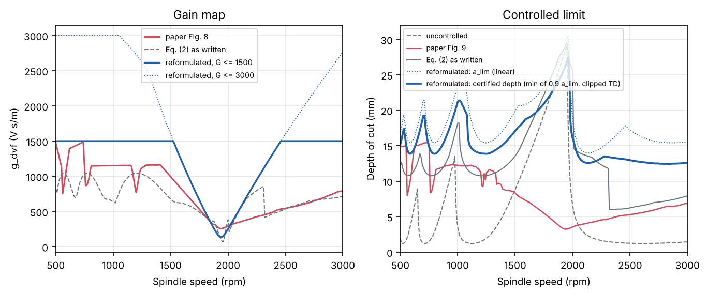

### 8.1 لماذا يحتاج شرط الورقة إلى إعادة صياغة

شرط المعادلة (2) يحاكي القطع عند $a_{\lim}$ بالضبط. هناك نمط الارتجاج حدّيّ: لا ينمو ولا يتلاشى،
فيتحدّد الطلب الأقصى بقوّة الإثارة عند دخول الأداة. ثلاث نتائج مقيسة لهذا (§5): الطلب يتقلّب مع
الكسب فيتشظّى مجال الجدوى (2280–2310 rpm)؛ وتُرفض كسوبٌ لا تُشبع المشغّل إلّا لحظة الدخول؛ ومن
هنا ينعكس الجدول 3.

### 8.2 الشرط الجديد ([`src/feasibility.py`](src/feasibility.py))

الكسب مقبول إذا لم يُشبع المشغّلَ **بعد استقرار القطع، عند أيّ عمق يسمح به**، أي لكلّ
$a\in(0,\,\kappa\,a_{\lim}(\Omega,g)]$ مع هامش $\kappa=0.9$. تحت $a_{\lim}$ يتلاشى الارتجاج،
فالحركة المستقرّة هي الاستجابة القسرية الدورية، ولها صيغة مغلقة:

* عند توافقيات مرور الأسنان يختفي عامل التجديد $1-e^{-i\omega_mT}$، فالاستجابة $G_{cl}(i\omega_m)F_m$؛
* قوّة الرقاقة الساكنة لكلّ شريحة واحدة، مُزاحة بتأخّر الحلزون، فالتكامل على العمق دقيق:
  $F_m(a)=W_m\,(1-e^{-imNa\tan\beta/R})/(imN\tan\beta/R)$. هذا العامل ينعدم عند مضاعفات خطوة
  الحلزون المحورية (12.57 mm)، وهو سبب تقلّب الطلب عند عمق واحد.

| فحص الشرط الجديد | النتيجة |
|---|---|
| الصيغة المغلقة مقابل الطلب المستقرّ في المحاكاة (24 حالة) | وسيط 0.3 %، أقصى 3.5 % عند الهامش |
| رتابة غلاف الطلب في الكسب (6 سرعات × 121 كسبًا) | رتيب: مجال الجدوى مجالٌ واحد $[0,g_b]$ |
| SADE مقابل التنصيف | SADE أفضل بـ ≤ 0.013 mm (التنصيف يتوقّف عند 0.25 V·s/m) |

### 8.3 ما كشفته الشهادة الزمنية: الإشباع عند الدخول يهمّ

الشرط المستقرّ لا يرى لحظة الدخول، لذلك تُتبَع كلّ نتيجة بمحاكاة من السكون بالمشغّل الحقيقي
المقصوص ($|V|\le9$ V). النتيجة: **الإشباع عند الدخول يدفع قطوعًا مستقرّة خطّيًّا إلى ارتجاج متنامٍ**
عند الكسوب الكبيرة. مثال: 2500 rpm و$g=1500$، الحدّ الخطّي 17.24 mm والعمق التشغيلي 15.51 mm،
لكنّ الحدّ الزمني بالمشغّل المقصوص 12.94 mm فقط. فالعمق المعتمد هو

$$a_{cert}=\min\big(\kappa\,a_{\lim}(g^*),\;a_{TD,\,\text{clipped}}(g^*)\big),$$

مع اختبار كلّ عمق على سلّم بخطوة 8 % حتى العمق التشغيلي، لأنّ الاستقرار مع الإشباع قد لا يكون رتيبًا
في العمق ([`src/run_feas_certify.py`](src/run_feas_certify.py)). الحدّ الزمني المقصوص يحكم عند
**126 من 251 سرعة**، وهي بالضبط السرعات التي فشلت فيها الشهادة عند العمق التشغيلي.

### 8.4 النتائج ($\mathcal G=[0,1500]$)

| المجال (rpm) | العمق المصدَّق | $a_{\lim}$ بالشرط الأصلي (بلا هامش) | منحنى الورقة | بلا تحكّم |
|---|---:|---:|---:|---:|
| 500–1150 | **16.52** | 12.36 | 12.64 | 4.02 |
| 1160–1490 | **14.75** | 11.49 | 10.12 | 3.87 |
| 1500–2050 | 20.44 | 21.24 | 5.31 | 16.58 |
| 2060–3000 | **12.79** | 8.47 | 5.38 | 1.51 |
| **الكلّ** | **15.74** | 12.75 | 7.92 | 5.85 |

(متوسّطات بالمليمتر. العمق المصدَّق يتضمّن هامش 10 %، أمّا عمود الشرط الأصلي فلا.)

* **الكسب** عند الحدّ الأعلى 1500 في 157 من 251 سرعة؛ وينخفض على شكل V حول **1940 rpm** (أدناه
  134.9) حيث يحدّه الاهتزاز القسري الرنّان. هذا الانخفاض موجود في الشكل 8 للورقة في الموضع نفسه، ولم
  يُظهره الشرط الأصلي.
* **أدنى عمق مصدَّق** 12.43 mm (2850 rpm)، مقابل 5.97 mm بالشرط الأصلي.
* **الكسب الثابت** يصير 134.9 V·s/m (60 بالشرط الأصلي، 237 في الورقة)، بمتوسّط $a_{\lim}$ ‏7.31 mm.
* **الجدول 3**: حيث يبلغ الكسب الحدّ الأعلى يصير «المقترح» وDVF المقصوص بالكسب نفسه، والحدّ الزمني
  المقصوص هو الشهادة نفسها (12.95 و12.43 و12.59 mm عند 2500 و2800 و3000 rpm). المقارنة تفقد معناها.
* **النقاط التجريبية**: لا تتغيّر المصادقة (19/21 بكسوب الورقة). وبكسوبنا الجديدة تُتنبّأ القطوع المتحكَّم
  فيها الثلاث المرتجّة مستقرّةً بفارق أكبر (حدود 15–16 mm)، لكنّها لم تُجرَّب بهذه الكسوب.

### 8.5 الحساسية ([`figures/r11_feasibility_sensitivity.png`](figures/r11_feasibility_sensitivity.png))

| الحالة | مدى الكسب | عند الحدّ الأعلى | ملاحظة |
|---|---|---:|---|
| الأساسية ($\kappa=0.9$، حارس 1.0، $\mathcal G\le1500$) | 134.9–1500 | 157 | العمق المصدَّق 15.74 mm |
| $\kappa=0.95$ | 134.8–1500 | 157 | الكسوب لا تتغيّر |
| حارس 0.85 ($F\le23$ N) | 100.7–1500 | 135 | يُخفّض الكسب حيث الطلب يحكم فقط |
| $\mathcal G\le3000$ | 134.8–3000 | 56 | العمق المصدَّق 16.82 mm؛ الشهادة تحكم عند 186 سرعة |

### 8.6 الخلاصة

الشرط الجديد **جيّد الطرح**: صيغة مغلقة سريعة، رتيب، ومجال جدوى واحد. لكنه يكشف أنّ القيد الحاسم
**ليس ذروة الطلب**: عند أكثر السرعات لا يحدّ الطلبُ المستقرّ الكسبَ أصلًا، فيحكم الحدّ الأعلى لمجال
البحث (غير المذكور في الورقة)، ويحكم العمقَ **الإشباعُ عند الدخول**. فالوعي الصحيح بالإشباع شهادةٌ زمنية
بالمشغّل المقصوص، لا قيدٌ على ذروة الطلب عند $a_{\lim}$.

**حدود:** الشهادة مسحٌ لا برهان (خطوة 8 %)؛ الصيغة المغلقة تُهمل الأثر الدوري (حتى 3.5 % أقلّ من
المحاكاة عند الهامش، والشهادة تغطّيه)؛ والنموذج نفسه غير مصادَق تجريبيًّا بهذه الكسوب.

## 9. اختبارات الانحدار

146 اختبارًا في [`tests/`](tests/) تثبّت ما يقوم عليه هذا التقرير، فيفشل أيّ تعديل لاحق يكسر المطابقة:

| الملف | ما يثبّته |
|---|---|
| `test_model.py` | قمّة FRF ‏−111.10 dB ومنحنى الشكل 6a، والحلقة المغلقة عند 1300 rpm وقطبها (−97.03، 805.4)، واستقرار حلقة DVF |
| `test_zoa.py` | منحنى الشكل 9 غير المتحكَّم فيه، وقمم الفصوص، والقيم الـ 96 لحلّال SDM المستقلّ، والجذر الزائف القديم |
| `test_tdsim.py` | تقارب الصيغة النهائية، والقوّة المتوسّطة التحليلية، وحدّ الجهد، وتقارب الطلب، ونتائج `check7` |
| `test_boundary_sade.py` | كاشف الارتجاج، والحدّ الزمني مقابل ZOA (بطيء)، وSADE على دالّة بحافّة جدوى |
| `test_feasibility.py` | الشرط الجديد: إلغاء الحلزون، والصيغة المغلقة مقابل المحاكاة، والرتابة، والشهادة، ونتائجه المخزّنة |
| `test_results.py` | أرقام التقرير المخزّنة: 18 سرعة لـ 237، ونسبة الكسب 0.97، وانعكاس الجدول 3، والنقاط المسترجَعة |
| `test_c1_entry.py` | خيارات المحاكي في §11: التطابق البتّي حين تُطفأ، وقوّة الدخول من الوجه ومنحدر التغذية مقابل صيغ مغلقة، والركلة، والتجديد المتعدّد، ودالّة الوصف، والقطع ثنائيّ الاستقرار عند 2500 rpm (بطيء) |
| `test_c1_results.py` | أرقام §11: 154/251، والدخول اللطيف، والشريط، والحوض، ودالّة الوصف، وهضبة الكسب، وإعادة اشتقاق ركلة حرجة مخزّنة بالمحاكي الحالي |
| `test_c2_certificate.py` | §12: نموذج تشيبيشيف عند الحدّ، واصطلاح المخروط، وشرط القطاع للمنطقة الميتة المتحرّكة، والمدار وحدّه، وشهادة صغيرة مفحوصة تصمد على نموذجها، ورفض النموذج غير المستقرّ، وحدّ الصلاحية، والاضطراب الكامل |
| `test_c2_results.py` | أرقام §12: 48/48 مفحوصة، 44/44 و29/29، و0/3456 خارج المحور، والدخول الحادّ المصدَّق دائمًا قبل الحدّ المحاكى |
| `test_c4_comb.py` | §13: البناء الثاني للمحاكي يطابق الافتراضي، والحدّان المتأخّران ينعدمان على المدار، والسرعة المتأخّرة، وخطأ تأخير المشط، وتأخير الحلقة، ونموذج تشيبيشيف (التقارب، والحدّ مقابل ZOA والمحاكي)، وإشارة $k_d$، وأمثل DVF = `feas_g3000`، والمشط بدور المغزل على الانحراف، والصيغة المغلقة مقابل نموذج تشيبيشيف والمحاكي، وأنّ هشاشة التأخير من طور المشط لا كسبه |
| `test_c4_results.py` | أرقام §13: الملخّص يُعاد بناؤه من النتائج، والحدّ الخطّي 1.78 و1.47 بلا حدّ، والدخول من الوجه والحادّ، وخريطة الكسب مقابل DVF بـ 26 كسبًا، و89/89 و97/97 و0/2304، و$g_1$ نفسه + D، والصيغة المغلقة مقابل المحاكي، وحدود المتانة |
| `test_c3_periodic.py` | §14: المعامل الدوري مقابل التكامل المستقلّ في verification، وتوافقيات القوّة بصيغة مغلقة، والإحاطتان تحتويان المعامل، وزوايا المثلّث تعيد مصفوفة التناقص، ودقّة لمّة Petersen، واستيفاء W، وحدّ Floquet مقابل ZOA وSDM (بطيء)، والاختزال إلى C2 (بطيء)، والدمج مقابل الزوايا (بطيء) |
| `test_c3_results.py` | أرقام §14: الملخّص، وFloquet ≥ ZOA، و47/48 و448/448 و0/3384، والنموذجان ±5 %، والغمر المنخفض، ومكوّنات الشهادة، وفصوص flip حيث المدار مشبَع، والمثال المضاد، وتصحيح حدّ الأمر في C2 وC4 |

```bash
cd ozsoy2026
python -m pytest tests                 # 135 اختبارًا سريعًا (≈ 60 ثانية)
python -m pytest tests --runslow       # 145 (≈ 90 ثانية)؛ الأخير يحتاج OZSOY_PDF
OZSOY_PDF=<paper.pdf> python -m pytest tests   # يضيف فحص الاسترجاع من الـ PDF
```

## 10. التشغيل

```bash
pip install numpy scipy matplotlib pymupdf
cd ozsoy2026/src
python extract_vector_figs.py <paper.pdf> ../digitized      # بيانات الأشكال (JSON + *_points.csv)
python run_gain_map.py --tag main --sade                     # الشكلان 8 و9 (≈ 3 ساعات على 4 أنوية)؛ يحفظ g_best/a_best
python run_single_gain.py --tag main --sade                  # الكسب الثابت
python run_table3.py --tag main                              # الجدول 3
python run_cuts.py --tag main                                # النقاط الـ 21 والقطوع الستّ
python run_gain_map.py --tag zeta145 --zeta 0.0145           # حساسيّات (مرجع فقط)
python run_gain_map.py --tag volt --kind volt
python run_gain_map.py --tag hold512 --fmode 0
# الشرط المُعاد صياغته (§8)؛ OMP_NUM_THREADS=1 يمنع تزاحم خيوط BLAS بين العمّال
export OMP_NUM_THREADS=1
python run_feasibility_map.py --tag g1500 --gmax 1500 --sade --certify
python run_feasibility_map.py --tag g3000 --gmax 3000 --certify
python run_feasibility_map.py --tag k095 --gmax 1500 --kappa 0.95
python run_feasibility_map.py --tag guard085 --gmax 1500 --guard 0.85
python run_feas_certify.py --tag g1500 && python run_feas_certify.py --tag g3000
python run_feas_compare.py --tag g1500
python figures.py --tag main
# C1 (§11): التجديد المتعدّد، ≈ ساعتان على 4 أنوية
../results/run_c1_chain.sh                 # df, basin, band, gainplane, map
python c1_summary.py && python figures_c1.py
# C2 (§12): pip install clarabel؛ ≈ ساعتان على 4 أنوية
../results/run_c2_chain.sh                 # validate, step, surface
python c2_summary.py && python figures_c2.py
# C4 (§13): ≈ 3 + 3 ساعات على 4 أنوية
../results/run_c4_chain.sh                 # limits, gainmap, entry, robust, validate
../results/run_c4_chain2.sh                # بعد المراجعة الثانية: limits, gainmap (DVF بشبكة دقيقة), robust, validate2
python c4_summary.py && python figures_c4.py
# C3 (§14): ≈ 8 ساعات على 4 أنوية (الذاكرة تحدّ العمّال)
../results/run_c3_chain.sh                 # floquet, basin, lowimm, decomp
python c3_periodic.py edge --workers 2 && python c3_periodic.py straight --workers 4 && python c3_periodic.py counter
python c3_summary.py && python figures_c3.py
```

المحاكي يُترجَم تلقائيًّا بـ gcc عند أوّل استيراد. كلّ المخرجات في [`results/`](results/)
والأشكال في [`figures/`](figures/).

## 11. C1: ثنائيّة الاستقرار الناتجة عن إشباع المشغّل

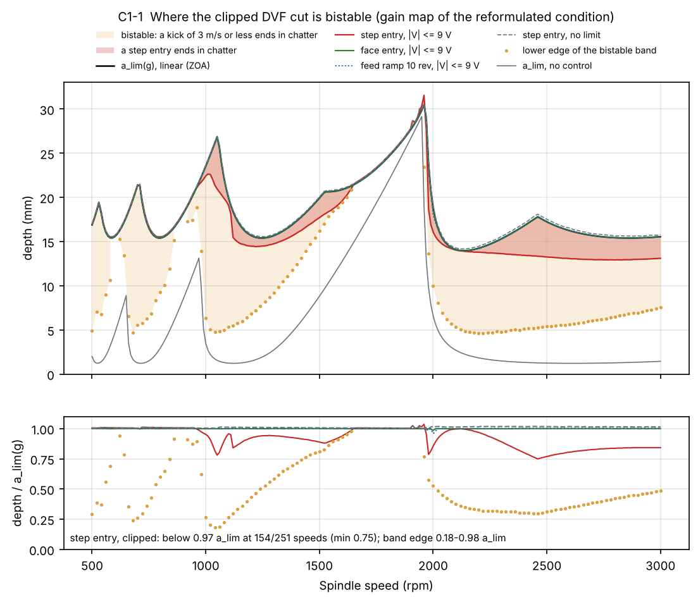

### 11.1 السؤال

§8.3 وجد أنّ الإشباع عند الدخول يُسقط قطوعًا مستقرّة خطّيًّا في الارتجاج. السؤال هنا: هل هذا عابرٌ
للدخول وحده، أم أنّ القطع **ثنائيّ الاستقرار** (قطع مستقرّ وارتجاج متعايشان)؟ وما حجم حوض القطع المستقرّ؟
هذه هي الفجوة البحثية C1: لا عمل في الأدبيات يشهد للاستقرار الإقليمي للتحكّم المشبَع بالارتجاج.

### 11.2 ما أُضيف للمحاكي ([`src/tdsim.c`](src/tdsim.c))

كلّ خيار مطفأ افتراضيًّا، والمسار حينها مطابق بتّيًّا للنسخة السابقة
([`verification/c1/reference_defaults.json`](verification/c1/reference_defaults.json)):

| الخيار | ما يفعله | الفحص |
|---|---|---|
| دخول من وجه القطعة | الأداة تتقدّم في وجه عمودي على التغذية، فيكتمل الاشتباك بعد R/fz سنًّا (40 دورة) | القوّة المتوسّطة تطابق تكامل قوّة الشريحة على القوس المشتبك إلى 4 منازل |
| منحدر التغذية | التغذية ترتفع من 0 خلال 10 دورات؛ الرقاقة = التقدّم خلال آخر سنّ | تطابق نقطيّ مع الرقاقة الهندسية (10⁻⁵) |
| ركلة | سرعة تُضاف للقطعة عند خطوة معيّنة | الاهتزاز الحرّ عند $f_n$ |
| تجديد متعدّد | الرقاقة أصغر رقاقة على آخر 4 مرور، فالسنّ التي خرجت من القطع لا تُحسب كأنّها أزالت مادّة | يطابق التجديد المفرد حين لا تخرج السنّ (10⁻¹⁵) |

راجعت ثلاثُ عدسات مستقلّة الإضافةَ (الحركيّات، والعدديّات، وتصميم الدراسة) وتحقّق مُفنِّدون من كلّ اكتشاف.
أُصلح ما ثبت: رقاقة منحدر التغذية، وطول الدخول، ونافذة الحكم بعد الركلة. واستُبعد منحدر العمق، لأنّ
النزول المحوري الحقيقي يُزيح تأخّر التجديد عبر الحلزون. وأهمّ ما وجدته المراجعة أنّ **التجديد المفرد**
يجعل الارتجاج المقصوص يتباعد بلا حدّ (فوق 1 cm)، ويصطنع الحدّ الأدنى للشريط. لذلك تستعمل كلّ نتائج §11
التجديدَ المتعدّد، فيستقرّ الارتجاج على دورة محدودة نحو 0.5 mm.

### 11.3 القطع نفسه، نتيجتان ([`c1_02`](figures/c1_02_same_cut_two_outcomes.png)، [`c1_03`](figures/c1_03_bistability_kicks.png))

2500 rpm، 15 mm، $g=1500$، $|V|\le9$ V (الحدّ الخطّي 17.24 mm): الدخول الحادّ ينتهي بارتجاج محدود
(نحو 500 µm)، والدخول من الوجه يستقرّ على المدار الدوري (أمر نحو 5 V). ثمّ رُكل القطع المستقرّ: ركلة
30 mm/s تُسقطه في الارتجاج مع الحدّ، وتتلاشى بلا حدّ. فهي ثنائيّة استقرار حقيقية، **مصدرها الإشباع**.

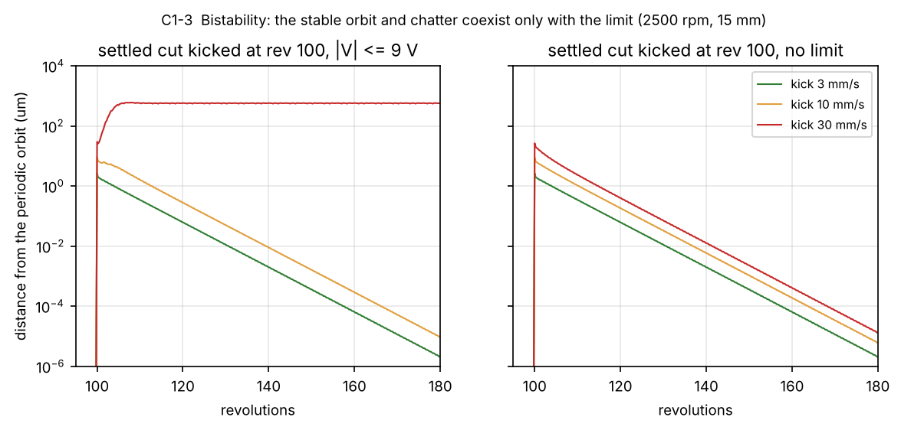

### 11.4 الخريطة على 251 سرعة ([`results/c1_map.csv`](results/c1_map.csv))

بخريطة الكسب في §8 ($\mathcal G\le1500$) وسلّم أعماق بخطوة 8 % حتى 1.05 من الحدّ:

| الدخول، مع $|V|\le9$ V | متوسّط الحدّ (mm) | الحدّ / $a_{\lim}$ | تحت 0.97 من الحدّ |
|---|---:|---|---:|
| حادّ (خطوة) | 16.89 | أدنى 0.749 (2460 rpm)، وسيط 0.934 | **154 / 251** |
| من وجه القطعة | 18.24 | أدنى 0.985 | 0 / 251 |
| منحدر تغذية 10 دورات | 18.24 | أدنى 0.957 | 1 / 251 (2000 rpm) |
| (مرجع: $a_{\lim}$ الخطّي) | 18.25 | | |

* الدخول اللطيف يستعيد **2.25 mm** وسطيًّا حيث يحكم الدخول الحادّ (حتى 5.9 mm). عند 2500 rpm:
  13.26 mm بالدخول الحادّ، و17.25 mm من الوجه.
* **شريط ثنائيّة الاستقرار** (كلّ 20 rpm؛ أصغر عمق تُسقطه فيه ركلة ≤ 3 m/s في 4 أطوار): يبدأ عند
  **0.18–0.98 من الحدّ (وسيط 0.42)**، ودائمًا فوق الحدّ غير المتحكَّم فيه (≥ 1.23 منه)، كما تتنبّأ دالّة الوصف:
  تحته يبقى القطع مستقرًّا حتى بمشغّل مشبَع تمامًا. ولم يوجد شريط عند 18 من 126 سرعة (600 و880 و900 rpm
  و1660–1940 rpm)، حيث الكسب صغير (135–979) أو الحدّ غير المتحكَّم فيه قريب من المتحكَّم فيه.
* الدخول الحادّ لا يكشف إلّا **أعلى الشريط**: حيث يتجاوز عابرُ الدخول حوضَ القطع المستقرّ.
* مرجع بلا حدّ للجهد: 1.00–1.03 من الحدّ. الزيادة الصغيرة فوق 1 أثرٌ من الكاشف D1، الذي يعدّ دورةً صغيرة
  فوق الحدّ «متلاشية» حين يُقترب منها من فوق. الدخول اللطيف يجلس على الحدّ نفسه.

### 11.5 حوض القطع المستقرّ ([`c1_04`](figures/c1_04_basin_vs_depth.png))

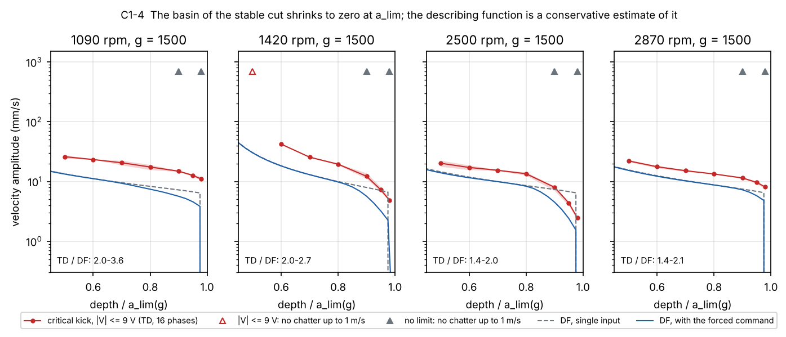

أصغر ركلة تُسقط القطع المستقرّ، 16 طورًا لكلّ سنّ، عند أربع سرعات:

| السرعة | الحوض محدود من | الركلة الحرجة عند 0.9 / 0.98 من الحدّ | نسبةً إلى دفع قطع سنّ واحدة عند 0.98 |
|---|---:|---:|---:|
| 1090 rpm | 0.25 | 15.4 / 11.5 mm/s | 4.2 % |
| 1420 rpm | 0.80 | 13.9 / 5.3 mm/s | 3.0 % |
| 2500 rpm | 0.40 | 8.3 / 2.6 mm/s | 2.6 % |
| 2870 rpm | 0.50 | 11.9 / 8.7 mm/s | 11.6 % |

* الحوض يضيق برتابة حتى ينعدم عند الحدّ الخطّي. **بلا حدّ للجهد لا ارتجاج لأيّ ركلة حتى 3 m/s**
  (0.3 و0.6 و0.9 و0.98 من الحدّ، كلّ السرعات والأطوار).
* تشتّت الطور صغير (≤ 15 %)، فالحوض خاصّيّة للقطع لا للطور.
* **دالّة الوصف ثنائيّة المدخل** (حول الأمر القسري) تتنبّأ بالحدّ الحرج للنمط. حُوِّلت إلى وحدة الركلة
  بمعامل يُقاس من القطع الخطّي المركول، وهو صالح فقط حيث يسود نمط الارتجاج (≥ 0.7–0.8 من الحدّ).
  النتيجة: **نسبة المحاكاة إلى دالّة الوصف 0.61–1.14**، وضمن نحو 10 % قرب الحدّ. فهي تقديرٌ رخيص للحوض.

### 11.6 مستوى الكسب ([`c1_05`](figures/c1_05_gain_plane.png))

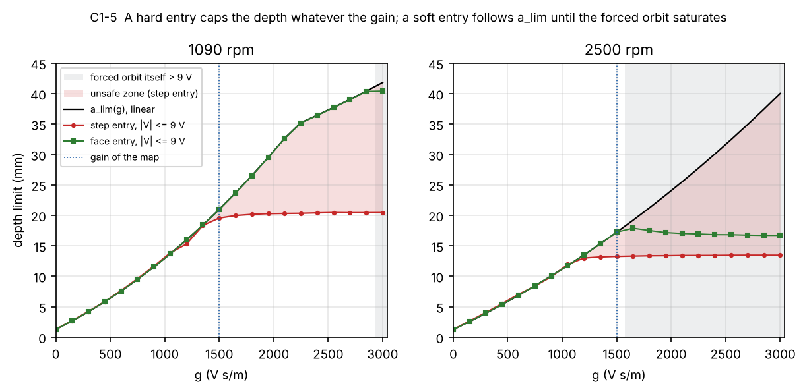

* بالدخول الحادّ **يتوقّف الحدّ عن الارتفاع مع الكسب**: هضبة 20.4 mm عند 1090 rpm و13.4 mm عند
  2500 rpm للكسوب ≥ 1500، بينما يرتفع الحدّ الخطّي إلى 41.8 و40.0 mm عند $g=3000$.
* بالدخول من الوجه يتبع الحدّ الخطّيَّ حتى يتجاوز **المدار القسري نفسه** 9 V: من $g=1650$ عند 2500 rpm
  (فيستقرّ نحو 16.7 mm)، وعند $g=3000$ فقط عند 1090 rpm (40.4 مقابل 41.8 mm).
* أي أنّ ما يحدّ العمق بالكسوب الكبيرة **ليس الكسب بل الحوض**، والطلب القسري (شرط §8) حدٌّ ثانٍ مستقلّ.

### 11.7 ما يعنيه هذا

1. **الشهادة الصحيحة هي الحوض لا الحدّ الخطّي.** قرب الحدّ تكفي ركلة بنسبة 2.6–11.6 % من دفع قطع
   سنّ واحدة. أيّ اضطراب حقيقي بهذا الحجم يُسقط القطع: لا تمركز الأداة، أو عدم تجانس المادّة، أو خروج
   الأداة من القطعة. فالهامش التشغيلي يجب أن يُعرَّف بحجم الحوض لا بنسبة ثابتة من الحدّ.
2. **استراتيجية الدخول متغيّر تحكّم.** الدخول من الوجه، وهو الطبيعي في الفريز الجانبي، يستعيد الحدّ الخطّي
   عند كلّ السرعات (≥ 0.985 منه). وشرط الجدوى في الورقة يحاكي الدخول الحادّ، فيعاقب ما لا يحدث في القطع الفعلي.
3. **رفع الكسب فوق نحو 1500 بلا فائدة مع الدخول الحادّ.** يجب أن يتضمّن تحسين خريطة الكسب الحوضَ لا الحدّ
   وحده.
4. دالّة الوصف تقديرٌ رخيص للحوض (ضمن عامل 0.61–1.14). الخطوة التالية C2: تقدير داخلي **مُبرهَن** للحوض
   (شرط قطاع معمَّم وLMI على خريطة SDM)، ثمّ C4 (§13).

**حدود:**
* نموذج بنمط واحد.
* حدّ الشريط الأدنى معرَّف بركلة ≤ 3 m/s، ويُفترض فيه أنّ الحوض يضيق برتابة مع العمق.
* معامل تحويل دالّة الوصف صالح فقط قرب الحدّ.
* الكاشف D1 يرفع المرجع غير المقصوص بنحو 1 %.
* عدم تمركز الأداة وتغيّر المادّة غير منمذجين، وهما بالضبط الاضطرابات التي قد تُسقط القطع.
* لا تجارب: التحقّق التجريبي هو C5.

## 12. C2: شهادة رياضية لحوض القطع المستقرّ

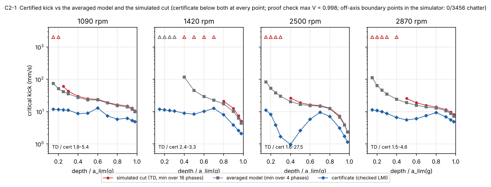

### 12.1 السؤال

C1 قاس حوض القطع المستقرّ بالمحاكاة. هنا السؤال: هل يمكن **ضمانه رياضيًّا دون محاكاة**؟ أي إيجاد منطقة
من الانحرافات حول المدار القسري يُبرهَن أنّ كلّ قطع يبدأ فيها يعود إلى المدار رغم إشباع المشغّل.
الأداة: شهادة LMI للأنظمة المشبَعة (Gomes da Silva & Tarbouriech)
([`src/c2_certificate.py`](src/c2_certificate.py)).

### 12.2 ما يُبرهَن عليه، ولأيّ نموذج

* **النموذج:** انحراف القطع عن المدار القسري في النموذج المتوسَّط (ZOA). الماضي المتأخّر يُمثَّل بقيمه عند
  N عقدة تشيبيشيف، فيصير نظامًا عاديًّا من الرتبة 4+N (N = 20–32). قيمه الذاتية تطابق المعادلة التأخيرية
  إلى 3×10⁻⁸، ويستعيد $a_{\lim}$ تمامًا.
* **القطاع:** حول الأمر القسري $b(t)$، الجزء المقصوص منطقة ميتة متحرّكة غير متناظرة. برهنّا أنّ شرط
  القطاع المعمَّم يصحّ بالمستوى $u_0=9-b_{\max}$ في كلّ لحظة. $b_{\max}$ حدٌّ أعلى مضمون على الدور كلّه:
  أكبر 4096 عيّنة مضافًا إليها حدٌّ بين العيّنات من توافقيات المدار.
* **المتراجحات:** تناقص دالّة ليابونوف بمعدّل اضمحلال لا يقلّ عن 5 % من معدّل النظام الخطّي. ويُشترط
  احتواء القطع الناقص في منطقة صحّة القطاع، وفي **منطقة صحّة نموذج القطع الخطّي**: $|x-x(t-T)|\le 0.5\,f_z$.
  والقطع الناقص يُعظَّم في اتجاه الركلة أو في اتجاه الدخول الحادّ.
* **ما يبقى خارجه:** معامل القطع الدوري في الزمن (±12 % حول متوسّطه)، وانعدام الرقاقة قرب زاوية الخروج.
  (C3، §14، يبرهن على النموذج الدوري نفسه.)
  **فالشهادة نظرية عن النموذج المتوسَّط، والنموذج المتوسَّط يُتحقَّق منه على المحاكي بشكل منفصل.**

### 12.3 كيف يُضمن أنّ الحلّ صحيح

* بُنيت مسألة SDP متناثرة مباشرة للمحلّل Clarabel، لأنّ cvxpy احتاج أكثر من 14 GB.
* المحلّل يتوقّف قبل الحلّ الأمثل. لذلك تُعاد كلّ مسألة ثلاث مرّات في إحداثيات مطبَّعة بالحلّ السابق
  (re-centring)، وهذا يرفع الشهادة 1.05–2.4 مرّة.
* **كلّ حلّ يُفحص باستقلال عن المحلّل:**
  * القيمة الذاتية الصغرى لمتراجحة التناقص يجب أن تتجاوز حدّ خطأ التقريب.
  * الاحتواء والحجم يُحسبان عبر تحليل Cholesky.
  * الاحتواء المتجاوَز قليلًا يُصلَح بتصغير القطع الناقص.
* جُرّبت دالّة ليابونوف دورية على دور السنّ بأجزاء قليلة، فلم تُعطِ مكسبًا يُذكر، فحُذفت. وC3 (§14) بيّن أنّها
  تحتاج 16 جزءًا فأكثر وهامشًا بحسب الطور، وحينئذٍ تربح 6–15 % على النموذج المتوسَّط.

### 12.4 التحقّق عند نقاط C1 الـ 48

| الفحص | النتيجة |
|---|---|
| البرهان على نموذجه: 48 بداية على حدود القطع الناقص، بالمنطقة الميتة الحقيقية | V لم تتجاوز 0.998 |
| الشهادة تحت الركلة الحرجة للنموذج المتوسَّط | **44 / 44** |
| النموذج المتوسَّط مقابل المحاكي (الركلة الحرجة) | 0.68–0.98 (الوسيط 0.92): أهشّ قليلًا، أي محافظ |
| الشهادة تحت الركلة الحرجة المحاكاة | **29 / 29**، بعامل 1.50–27.5 (الوسيط 2.32 من 0.7 من الحدّ فما فوق) |
| حدود القطع الناقص في 18 اتجاهًا × 4 أطوار، اضطرابًا كاملًا في المحاكي | **0 ارتجاج من 3456 تشغيلة** |

قيد الصلاحية أضافته المراجعة. فبدونه احتوى القطع الناقص عند 2500 rpm و0.7 من الحدّ حالاتٍ يكون فيها
الماضي مُزاحًا 7–12 مرّة $f_z$، أي الأداة خارج القطع تمامًا. هذه الحالات تعود في النموذج الخطّي لكنّها
ترتجّ في المحاكي (32 من 72 تشغيلة). ومع القيد صارت 0 من 72. وكلفته على محور الركلة 0–16 %.

### 12.5 الدخول الحادّ دون محاكاة ([`c2_02`](figures/c2_02_step_entry.png))

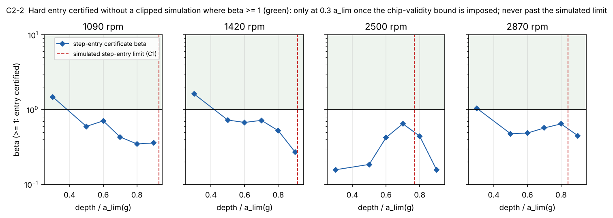

β ≥ 1 يعني أنّ القطع الداخل من السكون على سطح جديد مضمون الاستقرار:

| السرعة | β عند 0.3 / 0.5 / 0.7 / 0.9 من الحدّ | مصدَّق عند | الحدّ المحاكى (C1) |
|---|---|---|---:|
| 1090 rpm | 1.48 / 0.60 / 0.43 / 0.36 | 0.3 | 0.93 |
| 1420 rpm | 1.62 / 0.72 / 0.72 / 0.27 | 0.3 | 0.91 |
| 2500 rpm | 0.16 / 0.18 / 0.65 / 0.16 | — | 0.77 |
| 2870 rpm | 1.04 / 0.48 / 0.57 / 0.45 | 0.3 | 0.84 |

* كلّ ما صُدِّق يقع قبل الحدّ المحاكى، فلا تناقض.
* عند 1090 و2870 rpm يقع 0.3 من الحدّ فوق الحدّ غير المتحكَّم فيه بكثير، فالتصديق غير بديهي.
* لكنّ الشهادة **لا تبلغ الأعماق المنتجة**. بقيد الصلاحية، ومع تحفّظ يقارب مرّتين، لا تصل β إلى 1 فوق
  0.3 من الحدّ. وبدون القيد كانت 1420 rpm مصدَّقة حتى 0.7، لكن بقطع ناقص يحوي حالات خارج صحّة النموذج.

### 12.6 السطح المصدَّق ([`c2_03`](figures/c2_03_certified_surface.png))

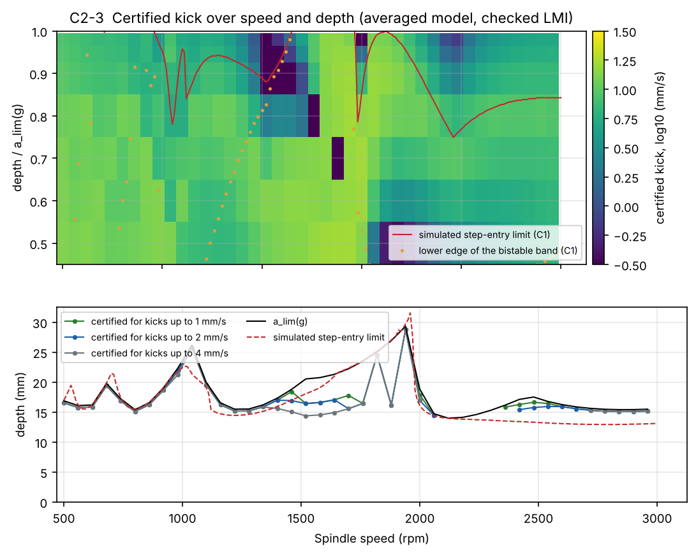

42 سرعة × 7 أعماق (0.5–0.98 من الحدّ):
* **287 من 294** نقطة مصدَّقة ومفحوصة. عند 0.9 من الحدّ الركلة المصدَّقة 0–16 mm/s (الوسيط 6.6).
* السبع الباقية في 1500–2000 rpm، حيث كسب الخريطة عند حدّ الطلب:
  * عند خمس منها يترك المدار القسري هامشًا معدومًا أو شبه معدوم ($u_0\le$ 0.14 V).
  * عند اثنتين (1520 و2000 rpm، 0.98 من الحدّ) الهامش صغير (0.38 و0.04 V) ولم يجتز أيّ مرشّح الفحص،
    وهذا قيدٌ عددي لا خاصّية للقطع.
* منها يُقرأ **العمق المصدَّق لاضطراب معطى**، أي أكبر عمق تبقى فيه الركلة المصدَّقة فوق 1 أو 2 أو 4 mm/s.
  الشبكة خشنة (7 أعماق)، فالمنحنيات مكمَّمة.

### 12.7 ما يعنيه، وما بعده

1. هذه أوّل شهادة استقرار إقليمي للتحكّم المشبَع بالارتجاج في التفريز ظهرت في بحثنا. هي مُبرهَنة على
   النموذج المتوسَّط، ولم يخرقها المحاكي في أيّ نقطة، على محور الركلة ولا خارجه.
2. التحفّظ نحو 2.3 مرّة قرب الحدّ، وهو الفجوة التي يجب سدّها. السبل: دوال Lur'e أو SOS، ومعامل القطع
   الدوري بحجّة متعدّد السطوح (±12 %)، أو الخريطة المتقطّعة SDM. والمعامل الدوري عولج في C3 (§14): الفجوة ليست
   من التوسيط.
3. الدخول الحادّ عند الأعماق المنتجة غير مصدَّق بعد. هذا كان دافع **C4** (§13). وبيّن C4 أنّ القيد هناك هو الإشباع عند الدخول، لا تخميد الحلقة؛ ويوسّع المنطقة
   المصدَّقة حتى تشمل الدخول.

**حدود:**
* البرهان على النموذج المتوسَّط لا على المحاكي.
* قيمة δ = 0.5 اختيار (δ = 1 يرفع الشهادة 0–15 %).
* هامش المدار في المحاكي بـ 30 طبقة أصغر بما يصل إلى 8 % من الصيغة المغلقة (تقطيع محوري)، ولا يقلب أيّ نتيجة.
* نمط واحد، ولا تجارب.

## 13. C4: سلطة المشغّل والحوض المصدَّق مع حدّ فرقٍ متأخّر

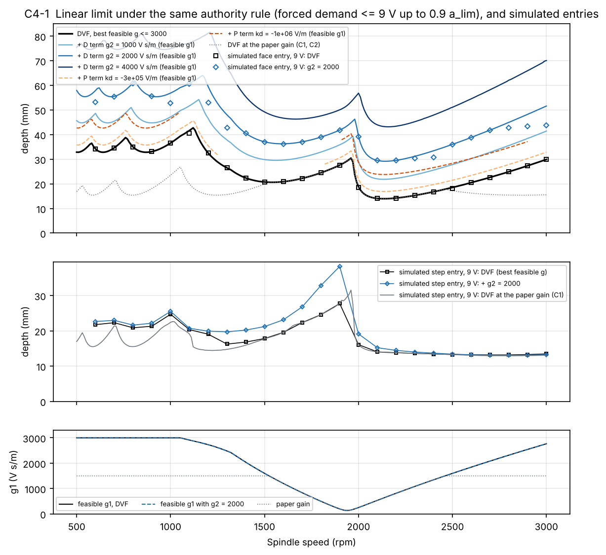

### 13.1 السؤال

في C1 وC2 يستهلك الاهتزاز القسري معظم الـ 9 V تحت DVF: عند 2500 rpm يبلغ أمر المدار 6–8.6 V عند معظم الأعماق
(و1–5 V فقط حيث يلغي الحلزون توافقيات السنّ). فلا يبقى للانحراف المسبِّب للارتجاج إلا جزء من فولت إلى 3 V، ويضيق
الحوض المصدَّق معه. السؤال هنا: هل يمكن صرف السلطة على الانحراف وحده؟ ([`src/c4_comb.py`](src/c4_comb.py))

### 13.2 قانون التحكّم: ما ليس جديدًا وما يضيفه C4

$$u=-g_1\dot x-g_2\big(\dot x-\dot x(t-T)\big)-k_d\big(x-x(t-T)\big)$$

* على أيّ حركة دورية بدور السنّ يصير $x(t)=x(t-T)$، فالحدّان المتأخّران **ينعدمان على المدار القسري**:
  أمره $-g_1\dot x_p$ أيًّا كان $g_2$ و$k_d$ ($1-e^{-sT}$ صفرٌ عند كلّ توافقيات مرور السنّ).
* لـ $g_1,g_2\ge0$ يكون $K(s)=g_1+g_2(1-e^{-sT})$ موجب الحقيقة ($\mathrm{Re}\,K\ge g_1$ في $\mathrm{Re}\,s\ge0$)،
  فحلقة السرعة مع مشغّل متجاور مثالي **بلا تأخير** سلبية (passive) كـ DVF. لكنّ هذا يسقط مع تأخير الحلقة (§13.9).
* **القانون منشور**، والمراجعتان المستقلّتان وجدتا ذلك (لم نذكره في المسوّدة الأولى):
  * Li وآخرون 2022 (IJAMT، doi 10.1007/s00170-022-09128-w): PD على $x(t)-x(t-T)$، بحجّة الجهد الأقلّ.
  * عدم التدخّل على المدار الدوري هو خاصّية تحكّم Pyragas المتأخّر (1992).
  * طُبّق على التفريز مع حدٍّ لفعل التحكّم عند van de Wouw وآخرين 2015 (IFAC-PapersOnLine، doi 10.1016/j.ifacol.2015.09.400).
  * van Dijk وvan de Wouw وNijmeijer 2015 (IJRNC 25(17):3495–3514، doi 10.1002/rnc.3280) صمّموا تغذية راجعة
    متأخّرة ثابتة البنية تنعدم على الحلّ الدوري، مع قوى المشغّل معيارًا للتصميم.
  * وانظر أيضًا Mancisidor وآخرين 2019 (Mechatronics، doi 10.1016/j.mechatronics.2019.102276: تأخير ضدّ الأثر
    التجديدي في الخراطة)، وDu وآخرين 2022 و2024، وLi وآخرين 2021 (MSSP: ترشيح مشطي لتوافقيات المغزل).
* **ما يضيفه C4 أضيق:** التحليل تحت **قصّ صلب** عند 9 V، أي:
  * ميزانية السلطة التي يستهلكها المدار القسري؛
  * الحوض المصدَّق مع القصّ (متراجحات C2 مع الحدود المتأخّرة في حجّة القطاع)؛
  * الكسوب التي تعظّمه، وما يحدث في المحاكي؛
  * حدود الافتراضات المثالية.
* **إشارة $k_d$:** القوّة التجديدية $\kappa a(x-x(t-T))$ و$\kappa<0$. لذلك $k_d<0$ يعاكسها، وكلّ $-10^5$ V/m
  يرفع الحدّ نحو 1 mm عند 2500 rpm. أمّا $k_d>0$ فيضيف إليها.
  المسبار الأوّل استعمل الإشارة الخاطئة، ونَسَب الضرر إلى نمط المشغّل خطأً؛ كشفته المراجعة.

### 13.3 ما أُضيف

* **المحاكي** ([`src/tdsim.c`](src/tdsim.c)): بناء ثانٍ (`COMB=1`) يُستعمل فقط حين يُطلب أحد الخيارات
  الجديدة. والبناء الافتراضي يطابق ما قبل C4 بتّيًّا: المصدر بعد المعالجة المسبقة والتفكيك متطابقان، واختبار
  البصمات يمرّ. الخيارات:
  * $g_2$ و$k_d$: السرعة المتأخّرة من مشتقّ متعدّد حدود Hermite للتاريخ المخزَّن، وهي صفر قبل $t=0$؛
  * تأخير المشط $\rho T$: لخطأ السرعة، أو $\rho=N$ لمشطٍ بدور المغزل؛
  * انحراف شعاعي لا مركزي للأسنان: الرقاقة المتجدّدة للسنّ $i$ تزيد $r_i-r_{i+k}$؛
  * تأخير الحلقة $\tau$، مع اختبار وحدة لأمره.
* **النموذج والشهادة** ([`src/c4_comb.py`](src/c4_comb.py)): نموذج تشيبيشيف من C2 مع صفّ الحدود المتأخّرة
  في حجّة المنطقة الميتة. المدار وحدّ أمره وشرط القطاع لا تتغيّر، لأنّ $b$ يعتمد على $g_1$ وحده.
* **الصيغة المغلقة** ([`src/c4_robust.py`](src/c4_robust.py)): المعادلة المميّزة بمتوسّط ZOA، ويُعدّ استقرارها
  بمبدأ الوسيط (argument principle)، مع:
  * تأخير الحلقة؛
  * نمط ثانٍ مفترَض؛
  * خطأ تأخير المشط؛
  * المدار القسري بتوافقيات المغزل كلّها مع الانحراف.
* **الفحوص:**
  * حدّ المحاكي مقابل نموذج تشيبيشيف ضمن 1.5 % (ثلاث حالات في الاختبارات البطيئة).
  * الصيغة المغلقة مقابل نموذج تشيبيشيف ضمن 2×10⁻⁴ (أربع حالات، الفرق الفعلي ≤ 3×10⁻⁵).
  * الصيغة المغلقة مقابل المحاكي:
    * حدود الاستقرار 1.003–1.015 في سبع حالات، منها مشط المغزل وخطأ التأخير وتأخير الحلقة 200–400 µs؛
    * أمر المدار ضمن 1.3 % في سبع حالات؛
    * الثامنة 29 % نسبيًّا (0.22 V)، عند 1090 rpm حيث الأمر نفسه 1 V فقط (إلغاء الحلزون).

### 13.4 خطّ أساس عادل

حدّ الكسب 1500 في C1–C2 افتراضٌ في هذه الإعادة، لا حدّ المشغّل. والمراجعة الأولى بيّنت أنّ مقارنة المشط بـ DVF
عند 1500 تضخّم الفائدة. لذلك تُقارن العائلتان **بالقاعدة نفسها** من [`src/feasibility.py`](src/feasibility.py):
يبقى الطلب القسري المستقرّ ≤ 9 V عند كلّ عمق حتى 0.9 من حدّ التصميم نفسه، مع $g_1\le3000$ للعائلتين.

* أمثلُ DVF بهذه القاعدة يطابق `feas_g3000` تمامًا (اختبار).
* DVF مقيَّد بالسلطة عند 195 من 251 سرعة (1060–3000 rpm)، وبحدّ الكسب عند الباقي.
* $g_1$ المسموح يكاد لا يتغيّر بإضافة $g_2$، لأنّ العمق الذي يقيّد الطلب أدنى من 0.9 من الحدّ. فالمقارنة
  عمليًّا: الكسب نفسه ± حدّ D.
* الحدّ يطال $g_1$ وحده، أمّا ذروة كسب المشط فهي $g_1+2g_2$. وعند السرعات الـ 56 التي يقف فيها DVF على
  الحدّ 3000، رُفع الحدّ عن العائلتين معًا (حتى 20000):
  * أمثل DVF يصير 3008–8761؛
  * والنسبة (D، $g_2$ = 2000) ÷ DVF **1.31–1.68 (الوسيط 1.47)**.

### 13.5 الحدّ الخطّي على 251 سرعة ([`c4_01`](figures/c4_01_limits.png))

| التصميم (g₁ بالقاعدة نفسها) | $a_{\lim}$ (mm) | ÷ أمثل DVF: الوسيط (المدى) | حيث DVF مقيَّد بالسلطة / بالكسب |
|---|---|---|---|
| DVF | 13.96–42.75 | 1 | — |
| + D، $g_2$ = 1000 | 21.85–54.26 | 1.43 (1.23–1.57) | 1.43 / 1.34 |
| + D، $g_2$ = 2000 | 29.18–64.08 | **1.78 (1.44–2.10)** | 1.81 / 1.64 |
| + D، $g_2$ = 4000 | 43.17–81.60 | 2.40 (1.75–3.15) | 2.50 / 2.20 |
| + P، $k_d$ = −3×10⁵ | 16.91–45.71 | 1.12 (1.07–1.21) | 1.13 / 1.09 |
| + P، $k_d$ = −10⁶ | 23.80–52.65 | 1.40 (1.23–1.70) | 1.45 / 1.29 |

الفائدة أكبر حيث DVF مقيَّد بالسلطة، لكنّها قائمة أيضًا حيث يقيّده حدّ الكسب، ومع رفع الحدّ (1.47).
فـ D يضيف هامشًا خطّيًّا بلا كلفة على المدار، وليس توزيع السلطة وحده.

### 13.6 الدخول في المحاكي (25 سرعة، بروتوكول C1)

| | DVF (الأمثل) | + $g_2$ = 2000 | النسبة |
|---|---|---|---|
| الدخول من الوجه، 9 V | 14.1–40.6 mm (≥ 0.974 من حدّه) | 29.5–60.8 mm (الوسيط 0.999، الأدنى 0.85) | **1.72 (1.45–2.12)** |
| الدخول الحادّ، 9 V | 13.2–27.7 mm | 13.1–38.3 mm | 1.04 (0.98–1.38) |

* **الدخول من الوجه يتبع الحدّ الخطّي الجديد** عند 16 من 25 سرعة. ويقف قبله (0.85–0.98) عند 600 و1000
  و1200 و1300 و2300 و2400 و2800–3000 rpm.
* **الدخول الحادّ من 2100 rpm فما فوق:** 13.1–15.2 mm مع D، مقابل 13.2–14.0 لـ DVF. يضيف D ≤ 1.2 mm (عند 2100 rpm؛ وفوقها ≤ 0.7 mm)، والكسب
  الأعلى لا يرفعه، فحدّه الإشباع عند الدخول لا التخميد. وبين 1300 و2000 rpm، حيث يقترب الدخول الحادّ من
  الحدّ الخطّي، يرفعه D حتى 1.38 مرّة.
* **الشريط ثنائيّ الاستقرار يتّسع كثيرًا.** نسبة الدخول الحادّ إلى الحدّ وسيطها 0.675 لـ DVF و0.411 مع D،
  وعرض الشريط (الحدّ ناقص الدخول الحادّ) وسيطه 7.3 مقابل 25.6 mm. فمعظم العمق المكسوب لا يُبلغ إلا بدخول
  لطيف، وحوضه بضعة mm/s (§13.8).
* **تصحيح:** المسوّدة الأولى عزت فشل الدخول الحادّ إلى انعدام السرعة المتأخّرة في الدور الأول، وكان ذلك خطأً.

### 13.7 خريطة الكسب المصدَّقة ([`c4_02`](figures/c4_02_gainmap.png))

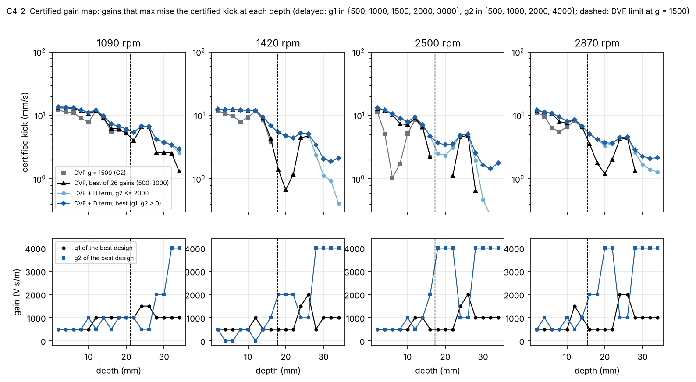

* **الشبكة:** 4 سرعات × 17 عمقًا (2–34 mm).
  * الأزواج المتأخّرة: $g_1\in\{500,1000,1500,2000,3000\}$ × $g_2\in\{500,1000,2000,4000\}$، أي 20 زوجًا.
  * DVF وحده على **26 كسبًا** (500–3000 بخطوة 100)، حتى لا يُظلم بعدد مرشّحين أقلّ. وجدت المراجعة الثانية
    أنّ الشبكة الخشنة (5 كسوب) كانت تُقصّر DVF.
  * كلّ شهادة مفحوصة باستقلال عن المحلّل.
* **العمق المصدَّق بلا ثغرة** (كلّ عمق في الشبكة حتى هذا مصدَّق بركلة ≥ D)، mm:

| D (mm/s) | | 1090 | 1420 | 2500 | 2870 rpm |
|---|---|---:|---:|---:|---:|
| 1 | أمثل DVF | 34 | 18 | 16 | 28 |
| | DVF + D (حتى $g_2$ = 4000) | ≥ 34 | ≥ 34 | ≥ 34 | ≥ 34 |
| | DVF + D ($g_2\le2000$) | ≥ 34 | 30 | 28 | ≥ 34 |
| 2 | أمثل DVF | 32 | 16 | 16 | 16 |
| | DVF + D | ≥ 34 | 30 | 28 | ≥ 34 |
| 4 | أمثل DVF | 26 | 16 | 14 | 14 |
| | DVF + D | 28 | 26 | 16 | 18 |

* **للعتبة وزنها:** 1 mm/s هو 0.5–1.3 % فقط من دفع سنّ واحدة عند 16 mm (و0.2–0.6 % عند 34 mm). أمّا C1 فوجد
  أنّ 2.6–11.6 % تُسقط القطع قرب الحدّ. عند 4 mm/s يضيق الفرق عند 2500 و2870 rpm إلى 2–4 mm.
* **العائلتان تسيران على نهج واحد:**
  * الكسب الأمثل لـ DVF وحده يرتفع مع العمق تدريجيًّا (500 ← 2200–2700)، فالشهادة تختار أصغر كسب يُبقي هامشًا
    خطّيًّا كافيًا، وهذا توزيعٌ للسلطة أيضًا؛
  * ومع D يبقى $g_1$ صغيرًا (500–1000)، ويرتفع $g_2$ إلى 2000–4000 بعد حدّ DVF، إلا عند 24–26 mm حيث يعود
    DVF مصدَّقًا، فيُختار $g_1$ = 1500–2000 مع $g_2$ = 500–1000.
* **الركلة المصدَّقة ليست الحوض الحقيقي:** في الأعماق المشتركة تكسب الشهادة 1.05–1.08 مرّة وسيطًا، و§13.8 تقيس
  الحوض نفسه.

### 13.8 التحقّق في المحاكي ([`c4_03`](figures/c4_03_validation.png))

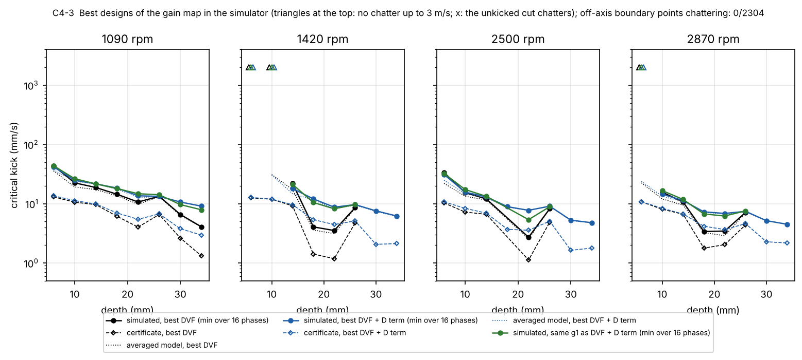

عند السرعات الأربع و6–34 mm، بالتصاميم التالية:
* أمثل DVF (الشبكة الدقيقة)؛
* أمثل DVF + D من الخريطة؛
* **و"$g_1$ نفسه + D"**: كسب DVF الأمثل نفسه مع أفضل $g_2$ له. أمر المدار والميزانية مطابقان لـ DVF، فأيّ
  تغيّر في الحوض سببه الحدّ المتأخّر وحده.

ولكلّ نقطة:
* الركلة الحرجة في المحاكي (بروتوكول C1، أدنى 16 طورًا)؛
* الشهادة بإعدادات المحلّل الصارمة، وفحص برهانها؛
* الركلة الحرجة للنموذج المتوسَّط؛
* ولتصميم الخريطة المتأخّر (لا لتصميم "$g_1$ نفسه") اختبار خارج المحور.

| الفحص (100 نقطة) | النتيجة |
|---|---|
| الشهادة تحت الركلة الحرجة المحاكاة | **89 / 89**، بعامل 1.61–7.44 (الوسيط 2.27) |
| الشهادة تحت ركلة النموذج المتوسَّط | **97 / 97**؛ البرهان على نموذجه V ≤ 0.998 |
| أعمق النقاط (30 و34 mm، $g_2$ حتى 4000) | 8 / 8، بعامل 2.07–3.67 |
| نقاط حدود القطع الناقص في المحاكي | **0 ارتجاج من 2304** |
| القطع غير المركول يرتجّ | 0 |

**هل يتّسع الحوض الحقيقي؟** مقارنة الركلة الحرجة المحاكاة عند العمق نفسه، 22 زوجًا:

| | ÷ أمثل DVF: الوسيط (المدى) | أفضل في |
|---|---|---|
| أمثل DVF + D من الخريطة | 1.12 (0.82–2.97) | 17 / 22 |
| **$g_1$ نفسه + D** (الميزانية نفسها) | **1.14 (0.96–2.58)** | 19 / 22 |

* **حيث يقترب DVF من حدّه يتّسع الحوض فعلًا، وبالميزانية نفسها:**
  * 1420 rpm، 18 mm: 10.5 مقابل 4.1 mm/s (2.6 مرّة)؛
  * 1420 rpm، 22 mm: 8.2 مقابل 3.5 (2.3 مرّة)؛
  * 2500 rpm، 22 mm: 5.4 مقابل 2.7 (2.0)؛
  * 2870 rpm، 18 mm: 6.7 مقابل 3.4 (2.0)؛
  * 2870 rpm، 22 mm: 6.2 مقابل 3.5 (1.8)؛
  * 1090 rpm، 34 mm: 7.9 مقابل 4.1 (1.9).
  وفي هذه الحالات يكفي $g_2$ = 500. فالحدّ المتأخّر يوسّع الحوض بهامشه الخطّي، لا بتحرير السلطة وحده.
* **توزيع السلطة يضيف أحيانًا:** عند 2500 rpm و22 mm يبلغ تصميم الخريطة ($g_1$ = 500، أمر المدار 2.5 بدل
  7.7 V) 7.7 mm/s، مقابل 5.4 للميزانية نفسها.
* **في الأعماق الضحلة لا يتّسع الحوض:**
  * بالميزانية نفسها النسبة 0.96–1.18؛
  * وتصميم الخريطة قد يُضيّقه، لأنّ الشهادة تختار $g_1$ أصغر (1420 rpm، 14 mm: 18.0 مقابل 22.1). فالكسوب
    الأمثل للشهادة ليست الأمثل للحوض.

### 13.9 المتانة: ما تتركه الافتراضات المثالية ([`c4_04`](figures/c4_04_robustness.png))

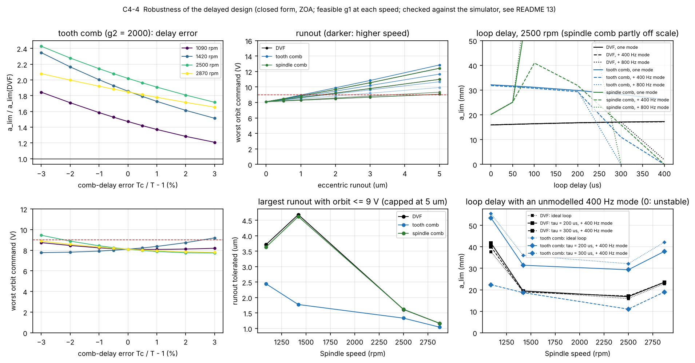

النتائج عند سرعات C1 الأربع بصيغة مغلقة متحقَّق منها بالمحاكي. التصاميم بهامش 10 % من الحدّ (الطلب ≤ 8.1 V)،
لأنّ التصميم عند 9 V بالضبط يُشبع عند أيّ اضطراب.

| الاضطراب | DVF | D، $g_2$ = 1000 | D، $g_2$ = 2000 | D، $g_2$ = 4000 |
|---|---|---|---|---|
| الحدّ الخطّي (mm) | 15.9–37.6 | 24.6–47.1 | 32.1–55.4 | 45.8–70.5 |
| انحراف لا مركزي يستهلك الهامش (µm، أسوأ 8 أطوار) | **1.12–4.50** | 1.22–3.22 | 1.03–2.42 | 0.69–1.73 |
| أكبر تأخير حلقة لا ينهار عنده الحدّ مع نمط ثانٍ مفترَض (400 أو 600 أو 800 Hz) | **300 µs** | 200 µs | 100 µs | 100 µs |

* **خطأ تأخير المشط**، $g_2$ = 2000 (سرعة المغزل، أو تقريب التأخير لعيّنات):
  * عند ±2 %: الحدّ يتغيّر +13/−10 % عند 2500 rpm، وأسوأ أمر مدار 7.8–8.9 V، ضمن الهامش.
  * عند ±3 % يتجاوز 9 V في حالتين من ثماني (2500 rpm عند −3 %، و1420 rpm عند +3 %).
  * الدخول من الوجه في المحاكي مع خطأ −2…+2 % يتبع الحدّ المنزاح (28.7–36.2 mm، ضمن 0.1 %).
* **تأخير الحلقة، بنمط واحد:** يهبط D تدريجيًّا، ويبقى فوق DVF. مثلًا عند 400 µs و$g_2$ = 2000: 24.0–35.8 mm
  مقابل 17.3–31.7.
* **الأنماط الثانية مفترَضة لا معرَّفة:** $k_2=6k$ عند 400 و600 Hz، و$k_2=40k$ عند 800 Hz، و$\zeta_2$ = 1 %.
  * عند 300 µs ونمط 400 Hz يصير $g_2$ = 2000 دون DVF عند السرعات الأربع (11.0–22.4 مقابل 17.1–40.1 mm).
  * عند 200 µs ونمط 600 Hz ينهار إلى 4.4–12.9 mm، بينما يبقى $g_2$ = 1000 فوق DVF (23.7–46.8 mm).
  * DVF نفسه ينهار عند 400 µs مع نمطَي 600 و800 Hz.
* **السبب طور المشط لا كسبه.** عند نقطة الانهيار (2500 rpm، 300 µs، 400 Hz) يقع الجذر عند 474 Hz، و$|K|$ هناك
  2861 فقط، دون الذروة $g_1+2g_2$ = 5396. لكنّ طوره −36° يُضاف إلى تأخّر الحلقة. وDVF بكسب ثابت يساوي ذروة
  المشط يبقى مستقرًّا أعمق بكثير (اختبار).
* **المشط بدور المغزل** ($\rho=N$) ينعدم على الانحراف، فيتحمّله كـ DVF، لكنّه ليس حلًّا:
  * حدّه الخطّي قريب من DVF عند $\tau=0$ (+0.3–4 %، عدا 2500 rpm: +27 %)؛
  * حسّاس جدًّا للطور: 20 ← 80 mm بتأخير 100 µs عند 2500 rpm؛
  * حسّاس جدًّا لخطأ السرعة: 13.6 V عند −2 %.

### 13.10 ما يعنيه، والحدود

1. **الآلية مقيسة، والمقارنة عادلة:**
   * حدّ D يرفع الحدّ الخطّي 1.44–2.10 مرّة (الوسيط 1.78) بالسلطة نفسها وحدّ الكسب نفسه، و1.31–1.68 مع رفع
     الحدّ عن العائلتين.
   * الدخول من الوجه في المحاكي يتبعه (1.45–2.12 مرّة).
   * الحوض المصدَّق بلا ثغرة (ركلة ≥ 1 mm/s) يبلغ 34 mm عند كلّ السرعات، مقابل 16–34 mm لأمثل DVF. والفرق
     يضيق عند عتبات أعلى.
   * في المحاكي يتّسع الحوض 1.8–2.6 مرّة قرب حدّ DVF **بالميزانية نفسها**، ولا يتّسع في الأعماق الضحلة.
2. **الدخول الحادّ عند السرعات العالية لا يتحسّن،** والشريط ثنائيّ الاستقرار يتّسع. فالعمق المكسوب يتطلّب
   دخولًا لطيفًا (C1)، وحوضه بضعة mm/s.
3. **الثمن متانة أقلّ،** وهي تُشترى بـ $g_2$:
   * طور $1-e^{-sT}$ يستهلك هامش الطور مع تأخير الحلقة، وتتأثّر به الأنماط غير المنمذجة.
   * ويرفع $g_2$ حساسية المدار للانحراف اللامركزي.
   * $g_2\approx1000$ يحتفظ بـ 1.2–1.6 مرّة من حدّ DVF، ويتحمّل 200 µs مع الأنماط المفترَضة. أمّا 2000–4000
     فيحتاجان حلقة ≤ 100 µs.
   * **التطبيق يتطلّب إذن:** حلقة سريعة، وFRF متعدّد الأنماط في التصميم، وتعويض طور فرع D (لم يُختبر)، وتأخيرًا
     متزامنًا مع المشفّر، وانحرافًا ≲ 1–2 µm.
4. **هامش السلطة مطلوب في التصميم.** القاعدة التي تضع الطلب عند 9 V بالضبط (كما في C1–C2) تنهار عند أوّل
   اضطراب. وهامش 10 % يكفي لخطأ سرعة ±2 % حتى $g_2$ = 2000 (عند $g_2$ = 4000 يتجاوز أمر المدار 9 V في 3 حالات
   من 8). ويكفي لانحراف 1.0–2.4 µm عند $g_2$ = 2000 (0.7–4.5 µm عبر التصاميم) بحسب السرعة.

**حدود:**
* نمط واحد معرَّف، والأنماط الثانية مفترَضة.
* النتائج الثانية (التأخير، النمط الثاني، الانحراف) بصيغة ZOA المغلقة، ومتحقَّق منها بالمحاكي إلا النمط الثاني.
* الانحراف في الرقاقة المتجدّدة فقط.
* لا ضجيج قياس ولا مدى حركة للمشغّل.
* لا تجارب: C5.

## 14. C3: الحوض المصدَّق على النموذج الدوري في الزمن

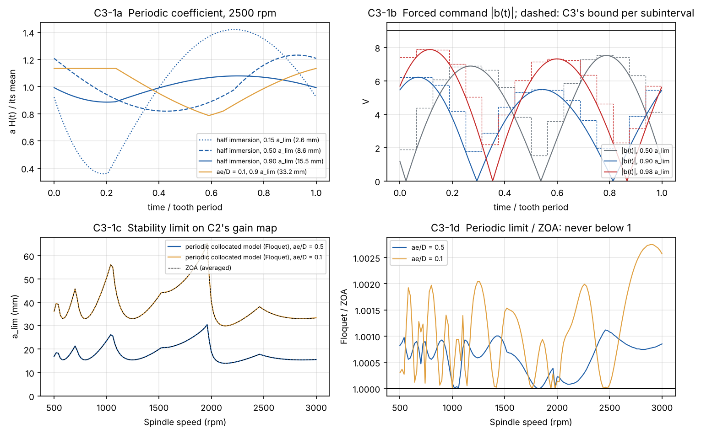

### 14.1 السؤال

برهان C2 عن **النموذج المتوسَّط** (ZOA): المعامل الاتجاهي للقوّة التجديدية يُستبدل بمتوسّطه على دور السنّ.
والقطع الحقيقي معامله دوري في الزمن، $aH(t)$، يتغيّر عند 2500 rpm من 0.89 إلى 1.08 من متوسّطه عند 0.9 من
الحدّ، ومن 0.36 إلى 1.42 عند 0.15 منه (C3-1a). والأمر القسري $b(t)$ يتغيّر هو الآخر على الدور (1–8 V، C3-1b)،
وC2 استعمل ذروته وحدها. السؤال: **هل يصحّ الحوض المصدَّق على النموذج الدوري نفسه، وهل يهمّ التوسيط للحوض لا
للحدّ الخطّي وحده؟** ([`src/c3_periodic.py`](src/c3_periodic.py))

### 14.2 ما يُبرهَن عليه

* **النموذج:** نموذج تشيبيشيف من C2 (الرتبة 4+N) مع $A(t)=A_0+aH(t)E$، و$aH(t)$ التكامل الدقيق على العمق للقاطع
  الحلزوني. متوسّطه $\kappa a$ من C2 تمامًا. المدار القسري هو مدار C2، لأنّ الحدّ التجديدي ينعدم على كلّ حركة
  بدور السنّ.
* **دالّة ليابونوف دورية:** $V=x^\top W(t)^{-1}x$، و$W(t)$ مستمرّة دورية وخطّية على كلّ من 16 جزءًا من الدور.
  $Y(t)$ خطّية بين العقد، و$S$ ثابت على كلّ جزء.
* **الإحاطة:** على كلّ جزء $aH=\alpha_k+\beta_k s+r$ و$|r|\le\varepsilon_k$ (خطّ بالمربّعات الصغرى وأكبر بقية،
  مع حدٍّ بين العيّنات). مصفوفة التناقص خطّية في $(s,\sigma=s^2)$ لكلّ $r$، وخطّية في $r$ لكلّ $(s,\sigma)$.
  و$(s,s^2)$ داخل المثلّث $(0,0),(\tfrac12,0),(1,1)$. فإيجابيّتها عند الزوايا الستّ (3 × 2) تكفي للجزء كلّه
  (تركيب محدّب).
* **هامش بحسب الطور:** شرط القطاع آني، فيُستعمل على كلّ جزء $u_{0,k}=9-\max|b|$ عليه، لا $9-b_{\max}$ على الدور
  كلّه.
* **ما يُبرهَن:** الأنبوب $\{(t,x):x^\top W(t)^{-1}x\le1\}$ لا يُغادَر، وV تتناقص فيه تناقصًا صارمًا. فالانحراف
  عند الطور $t_0$ داخل $E(W(t_0))$ يعود إلى المدار. الركلة المصدَّقة لأيّ طور هي الأصغر على العقد (دقيق، لأنّ $W$
  خطّية بينها)، وتُحسب أيضًا عند أطوار C1 الـ 16.
* **قيد الصلاحية** $|x-x(t-T)|\le0.5f_z$ وحجم القطع الناقص كما في C2، عند كلّ عقدة.

### 14.3 ما ليس جديدًا وما الجديد

* **مصفوفة ليابونوف خطّية قطعيًّا في الزمن**، مع المتراجحات عند نهايات الأجزاء × رؤوس متعدّد السطوح:
  Allerhand & Shaked 2011 (IEEE TAC، https://ieeexplore.ieee.org/document/5659466)، ودوالّ Briat المعتمدة على
  الساعة (arXiv 1304.1998). والأنظمة الدورية القطعية Li وآخرون 2015 (Automatica).
* **مناطق الجذب للأنظمة الدورية المشبَعة:** Zhou وآخرون 2011 (Automatica، زمن متقطّع)، ومع التأخير
  Satheesh وآخرون 2022 (JDSMC). وشرط القطاع المعمَّم Gomes da Silva & Tarbouriech 2005. ولمّة Petersen (1987)
  لدمج الزاويتين.
* **تجميع تشيبيشيف لمعادلة التفريز الدورية:** Butcher وآخرون 2009 (JCND). وفشل التوسيط عند الغمر المنخفض
  كلاسيكي: Davies 2002، Bayly 2003، Insperger & Stepan 2004، Merdol & Altintas 2004، وأثر الحلزون
  Sanz-Calle وآخرون 2024.
* **أحواض القطع ثنائيّ الاستقرار** درسها Dombovari & Stepan 2015 بالاستمرار والمحاكاة، بلا شهادة ولا مشغّل.
* **الجديد** (في حدود البحث): شهادة منطقة جذب لتحكّم مشبَع بالارتجاج على **النموذج الدوري**. فيها منطقة ميتة
  تتحرّك حول أمرٍ قسريٍّ دوري، بهامش بحسب الطور، مع قيد صلاحية الرقاقة، وفحص مستقلّ عن المحلّل.

### 14.4 الحدّ الخطّي: التوسيط محافظ قليلًا على هذا القاطع ([`c3_01`](figures/c3_01_coefficient.png))

حدّ Floquet للنموذج الدوري (126 سرعة على خريطة كسب C2، المونودرومي بـ Magnus من الرتبة 4):

| الغمر الشعاعي | Floquet ÷ ZOA | تحت ZOA | فصّ flip | تقارب العقد (N+8) |
|---|---|---|---|---|
| ae/D = 0.5 | 1.0000–1.0011 | 0 | 0 | ≤ 5×10⁻⁶ |
| ae/D = 0.1 | 1.0000–1.0028 | 0 | 0 | ≤ 6×10⁻⁶ |

* يطابق شبه التقطيع المستقلّ (verification/zoa_sdm) ضمن 0.2 %.
* السبب هندسي: الخطوة المحورية للأسنان 12.6 mm، والحدود هنا 14–30 mm عند نصف الغمر و30–65 mm عند 0.1، أي 1–5
  خطوات. فيلغي الحلزون معظم تغيّر $aH(t)$. وعند الأعماق التي هي مضاعفات الخطوة تصير النسبة 1 تمامًا.
* **فصوص flip موجودة بأسنان مستقيمة** (حتى 5 % تحت ZOA عند 1650–1950 rpm بلا تحكّم). لكنّ DVF يزيلها من
  $g\approx250$. وحيث تبقى ($g\le150$) يحتاج المدار القسري بالأسنان المستقيمة وحده 54–66 V، فلا يدّعي C2
  شيئًا هناك. **فلم نجد نقطةً يخطئ فيها برهان C2 المتوسَّط بسبب التوسيط.**

### 14.5 الحوض عند نقاط C1 الـ 48 ([`c3_02`](figures/c3_02_basin.png)، [`c3_03`](figures/c3_03_phase.png))

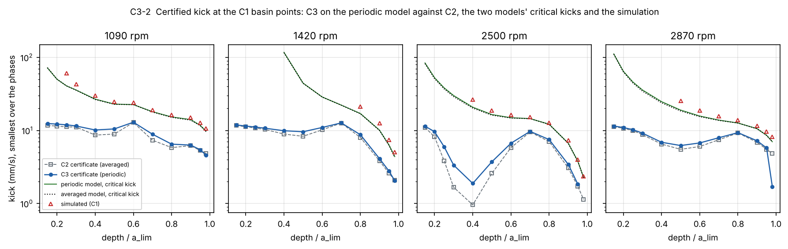

| الفحص | النتيجة |
|---|---|
| نقاط مصدَّقة على النموذج الدوري | **47 / 48** (تفشل 2500 rpm عند 0.98 من الحدّ) |
| C3 ÷ C2 | 0.35–2.01 (الوسيط **1.064**)؛ أعلى من C2 في 44 / 47 |
| عند 2500 rpm | 1.02–2.01 (الوسيط 1.15)؛ ضعف C2 عند 0.3–0.4 من الحدّ |
| البرهان على نموذجه: 48 بداية على حدود الأنبوب بأطوار عشوائية | V لم تتجاوز 0.997 |
| الشهادة عند الطور تحت الركلة الحرجة للنموذج الدوري عند الطور نفسه | **752 / 752** |
| الشهادة عند الطور تحت الركلة الحرجة **المحاكاة** عند الطور نفسه (أطوار C1 الـ 16) | **448 / 448** |
| حدود $E(W(t_k))$ في 18 اتجاهًا × 4 أطوار، اضطرابًا كاملًا في المحاكي | **0 ارتجاج من 3384 تشغيلة** |
| شهادة C2 تحت الركلة الحرجة للنموذج الدوري | 48 / 48 |
| الركلة الحرجة: النموذج الدوري ÷ المتوسَّط، طورًا بطور (704 زوجًا) | 0.973–1.052 (الوسيط 1.001) |
| المحاكي ÷ الشهادة من 0.7 من الحدّ | C3: 1.49–4.84 (الوسيط 2.24)؛ C2: 1.50–3.27 (الوسيط 2.35) |

* **التوسيط لا يهمّ الحوض هنا:** حرج النموذجين يتطابق ضمن ±5 % طورًا بطور، وشهادة C2 صحيحة على النموذج الدوري
  عند كلّ النقاط (مقارنةً بركلته الحرجة، لا برهانًا).
* **المكسب من الهامش بحسب الطور:** حيث يتغيّر الأمر القسري كثيرًا على الدور تتّسع الشهادة 1.4–2.0 مرّة. مثال
  ذلك 2500 rpm عند 0.25–0.5 من الحدّ: $u_0$ في أسوأ جزء 0.45–1.5 V، وفي أفضله 6.8–7.5 V. وحيث الهامش متقارب
  يبقى المكسب بضعة في المئة.
* **قرب الحدّ (0.98)** تقلّ الشهادة الدورية عن C2 عند 1090 و1420 و2870 rpm (0.95، 0.98، 0.35 منها)، وتفشل
  عند 2500 rpm. معدّل الاضمحلال هناك صغير، وتغيّر المعامل على الدور يأكله. هذا ثمن البرهان على النموذج الحقيقي.
* الشهادة عند الطور (C3-3) شبه ثابتة: المسألة تعظّم الطور الأسوأ، فلا تقيس اعتماد الحوض على الطور، بل تبقى تحت
  الحرج المحاكى عند كلّ طور.

### 14.6 ماذا يضيف كلّ مكوّن ([`c3_04`](figures/c3_04_decomp.png))

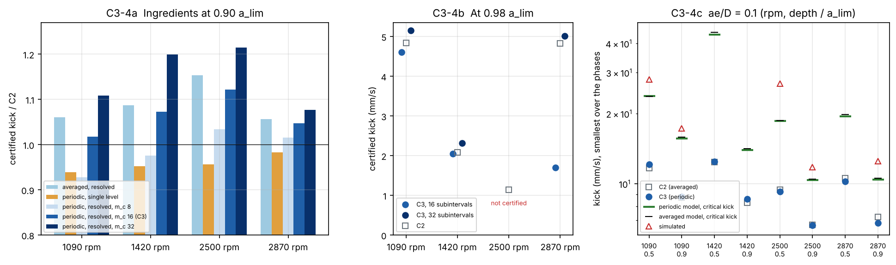

عند 0.9 من الحدّ، الشهادة ÷ C2:

| المتغيّر | 1090 | 1420 | 2500 | 2870 rpm |
|---|---|---|---|---|
| المتوسَّط + الهامش بحسب الطور (16 جزءًا) | 1.06 | 1.09 | 1.15 | 1.06 |
| الدوري + مستوى C2 الواحد (16) | 0.94 | 0.95 | 0.96 | 0.98 |
| الدوري + الهامش بحسب الطور، 8 أجزاء | 0.93 | 0.98 | 1.03 | 1.02 |
| **الدوري + الهامش بحسب الطور، 16 جزءًا (C3)** | **1.02** | **1.07** | **1.12** | **1.05** |
| الدوري + الهامش بحسب الطور، 32 جزءًا | 1.11 | 1.20 | 1.22 | 1.08 |

* **المعامل الدوري وحده يكلّف 2–6 %**، وهذا ثمن البرهان على النموذج الحقيقي.
* **والهامش بحسب الطور يربح 6–15 %**. والصافي عند 16 جزءًا +2 إلى +12 %.
* **الشهادة لم تتقارب في عدد الأجزاء:** 32 جزءًا تضيف 3–12 % فوق 16، بضعف الذاكرة والزمن تقريبًا. فأرقام §14.5
  محافظة.
* قرب الحدّ: {EDGE}
* مع 8 أجزاء تخسر الشهادة أمام C2 عند 1090 rpm (0.93). فدالّة ليابونوف الدورية تحتاج دقّة زمنية كافية.
  ولهذا لم تُعطِ تجربة C2 السابقة، بأجزاء قليلة على النموذج المتوسَّط، مكسبًا يُذكر (§12.3).


### 14.7 الغمر الشعاعي المنخفض (ae/D = 0.1)

هنا يتغيّر $aH(t)$ أكثر: 0.66–1.40 من متوسّطه عند 0.5 من الحدّ، و0.79–1.24 عند 0.9 (ونصف الغمر 0.77–1.27 و0.88–1.11).
والحدود 30–65 mm. عند السرعات الأربع × 0.5 و0.9 من الحدّ:

| الفحص | النتيجة |
|---|---|
| مصدَّقة | **8 / 8**؛ C3 ÷ C2 = 0.94–1.04 (الوسيط 1.00) |
| النموذج الدوري ÷ المتوسَّط (الركلة الحرجة، طورًا بطور) | 0.974–1.052 |
| الشهادة تحت الركلة المحاكاة (C1، 4 أطوار) | 8 / 8، و19 / 19 طورًا |
| البرهان على نموذجه / خارج المحور في المحاكي | V ≤ 0.996 / 0 من 576 |

### 14.8 أين يخطئ التوسيط ([`c3_05`](figures/c3_05_averaging.png))

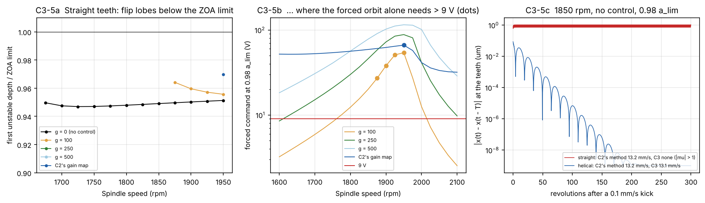

بأسنان مستقيمة (لا حلزون) يتغيّر $aH(t)$ تغيّرًا حادًّا، فتظهر فصوص flip تحت حدّ ZOA (نصف الغمر، 1600–2100 rpm):

| كسب DVF | سرعات غير مستقرّة تحت حدّ ZOA | الأمر القسري حيث عدم الاستقرار |
|---|---|---|
| 0 (بلا تحكّم) | 12 / 21 (1675–1950 rpm، من 0.947 منه) | لا أمر |
| 100 | 4 / 21 (من 0.956) | 27–54 V |
| 250 و500 | 0 / 21 | — |
| خريطة C2 | 1 / 21 (1950 rpm، من 0.970) | 66 V |

* حيث يُخطئ التوسيط مع DVF، يحتاج المدار القسري وحده 27–66 V، فلا يدّعي C2 شيئًا هناك.
* **بلا تحكّم** لا أمر، وطريقة C2 تدّعي. المثال المضاد عند 1850 rpm و0.98 من حدّ ZOA:

| القاطع | مضاعِف Floquet | شهادة C2 (المتوسَّطة) | شهادة C3 (الدورية) | المحاكي بعد ركلة 0.1 mm/s |
|---|---|---|---|---|
| أسنان مستقيمة | 1.034 عند 180° | 13.2 mm/s | لا شيء: غير مستقرّ | يرتجّ: اهتزاز بدورين لا يخمد (≈ 1 µm) |
| حلزون 45° (الورقة) | 0.977 | 13.2 mm/s | 13.1 mm/s | يستقرّ |

النموذج المتوسَّط لا يعرف الحلزون، فشهادته واحدة للقاطعين. أمّا الشهادة الدورية فتفرّق بينهما.

### 14.9 الحساب: ما لزم ليعمل

* **نقطة البداية:** الحلّ الأوّل في إحداثيات شهادة C2 (تطبيع ثابت؛ والمتغيّر في الزمن يضيف حدًّا إلى $A(t)$).
  بدونها احتاج المحلّل 150–200 تكرارًا وتوقّف قبل الحلّ.
* **دمج الزاويتين:** $E$ من الرتبة الأولى، فتُدمج زاويتا $r=\pm\varepsilon$ لكلّ $(s,\sigma)$ في متراجحة واحدة
  بلمّة Petersen (دقيقة لمتغيّر قياسي). هذا أسرع 3–4 مرّات، والنتيجة نفسها (3.1246 مقابل 3.1246 mm/s).
* **الفشل عند أوّل خطوة:** المسألة المدموجة فشلت في المحلّل عند نصف النقاط في التشغيل الأوّل (16 / 48 فقط
  مصدَّقة). السبب سوء توازن كتلة المضاعِف: بقية صغيرة بجانب حدود بحجم $|A|$. أصلحه تقسيم $pq^\top$ بعامل 10
  (47 / 48). ويبقى احتياطًا التنظيم الأقوى، ثمّ الزوايا الستّ منفصلة.
* **فحص مستقلّ عن المحلّل** عند كلّ زاوية من 6×16 وكلّ عقدة، مع حدّ تقريب يشمل $\dot W$. ويُصلح الاحتواء
  المتجاوَز بتصغيرٍ واحد لكلّ $(W_k,Y_k,S_k)$ معًا، لأنّ كلّ المتراجحات متجانسة.
* **الكلفة:** 4–10 دقائق للنقطة بـ 16 جزءًا. الذاكرة 2–5 GB، و4.7 GB للزوايا المنفصلة عند N = 24. حلّ واحد
  ثقيل في الوقت نفسه.
* **مراجعة الشيفرة** وجدت خطأين صُحّحا:
  * توافقيات قوّة الشريحة في `feasibility.py` من DFT بـ 4096 نقطة تقع قفزة الدخول على عيّنة منه. فكلّ معامل
    مُزاح حتى 4 N/m، والأمر القسري حتى 3.4 mV. والمدار المقطوع عند 40 توافقية يترك حتى 1.4 mV أخرى. صار في C3
    صيغة مغلقة مع حدٍّ للبقية.
  * دقّة الركلة الحرجة للنموذج كانت 2 %، فصارت 0.06 %.
* **أثر ذلك على C2 وC4:** تصغير شهاداتهما إلى الحدّ الصحيح للأمر يغيّرها بعامل 0.997–1 عند نقاط C2 الـ 48.
  ولا يغيّر أيّ رقم مذكور في §12 و§13 (`errata` في [`results/c3_summary.json`](results/c3_summary.json)).

### 14.10 ما يعنيه، والحدود

1. **برهان C2 صمد على النموذج الدوري:** حرج النموذجين يتطابق ضمن ±5 % طورًا بطور. وشهادة C2 تحت الحرج الدوري
   عند كلّ النقاط. وحدّ Floquet لا ينزل عن ZOA على خريطة الكسب، ولا عند الغمر المنخفض. فالتحفّظ نحو 2.3 مرّة
   قرب الحدّ ليس من التوسيط.
2. **الشهادة الدورية** تصدّق 47 / 48 نقطة، بزيادة وسيطة 6 % عن C2، وحتى الضعف حيث يتغيّر الأمر القسري على
   الدور. ولم يخرقها المحاكي في أيّ طور (448 / 448)، ولا خارج المحور (0 / 3384).
3. **التوسيط يخطئ بأسنان مستقيمة**، وطريقة C2 تصدّق حينئذٍ قطعًا غير مستقرّ؛ والشهادة الدورية ترفضه. لكن مع
   DVF يقع هذا حيث يتجاوز المدار القسري 9 V، فلا يدّعي C2 شيئًا هناك.

**حدود:**
* البرهان عن نموذج التجميع الدوري (N عقدة)، لا عن المعادلة التأخيرية نفسها. وانتقاله إليها يحتاج دالّة
  Lyapunov–Krasovskii (Seuret وآخرون 2019).
* لا يُدّعى معدّل اضمحلال: الفحص المستقلّ للتناقص الصارم فقط.
* الدخول الحادّ يحتاج شرطًا بحسب الطور، فلم يُحسب هنا.
* الشهادة لم تتقارب في عدد الأجزاء (+3–12 % من 16 إلى 32).
* نمط واحد، ولا تجارب.
